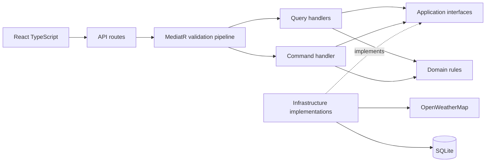

# Xtramile Weather

ASP.NET Core weather API and a separate React TypeScript client for the Xtramile practical assessment. Select a country/city, inspect current weather, and save a persistent weather note. Weather comes from OpenWeatherMap; tests use synthetic responses and require no API key.

## Architecture and CQRS decoupling

Backend layers are folders inside `src/WeatherApp/`, as requested for AI-assisted assessment implementations:

| Folder | Responsibility | Dependencies |
| --- | --- | --- |
| Domain | Temperature conversion, weather-note entity and rules | .NET base library only |
| Application | Commands, queries, DTOs, validators, handlers, interfaces | Domain, MediatR, FluentValidation |
| Infrastructure | SQLite/EF Core persistence, bundled locations, OpenWeatherMap HTTP adapter | Application, Domain |
| API | Thin routes, Problem Details, composition root | Application; Infrastructure only for registration |
| frontend | React TypeScript, API client, component and browser tests | HTTP contracts |



CQRS separates read requests from state-changing requests. `GET /api/weather/Jakarta?countryCode=ID` sends `GetWeatherQuery`; validation checks the input, its handler resolves the catalog location and uses `IWeatherService`. The infrastructure adapter fetches imperial weather, converts Fahrenheit to Celsius through Domain, and returns `WeatherDto`. The endpoint never calls HttpClient or EF Core directly.

`POST /api/weather/notes` sends `CreateWeatherNoteCommand`; FluentValidation rejects invalid payloads before the handler runs. The handler constructs a Domain note and calls `IWeatherNoteRepository`. Its EF Core implementation awaits `SaveChangesAsync` before returning an identifier. Application interfaces allow tests to replace external concerns without changing handlers. This design uses one database; CQRS does not introduce separate databases, event sourcing, or a broker. Every EF Core read in the test/verification paths explicitly uses `AsNoTracking()`; runtime catalog/weather reads are not database reads.

## Prerequisites and setup

- .NET SDK 10, Node.js 22.12 or newer compatible release (Node 22 recommended), npm.
- Docker Desktop/Engine with Linux containers for container delivery; native development also works.
- An OpenWeatherMap key with access to the Current Weather API for live weather.

From the repository root:

```powershell
dotnet restore WeatherApp.slnx
cd frontend
npm ci
npx playwright install chromium
cd ..
```

For Linux browser-test setup, use `npx playwright install --with-deps chromium`. Installation downloads dependencies/browser binaries; test execution itself does not call external services.

## Run locally

Set the server key through an environment variable in the backend terminal:

```powershell
$env:OpenWeatherMap__ApiKey = 'your-key'
dotnet run --project src/WeatherApp --launch-profile http
```

In a second terminal:

```powershell
cd frontend
npm run dev
```

Open http://localhost:5173. Vite proxies `/api` to http://localhost:5000. The key stays on the server; never put it in a `VITE_*` variable. Without a key, countries/cities and notes work; weather returns a clear 503 configuration error. No fake weather fallback is enabled.

The default SQLite file is `src/WeatherApp/data/weather.db` in native development. Override `ConnectionStrings__Weather` with a SQLite connection string to change it. Relative paths resolve against the backend content root. Startup creates the directory and initializes the schema with `EnsureCreated`. This bounded assessment has a fixed schema; future schema changes need a deliberate migration strategy rather than mixing EnsureCreated with migrations. Notes survive process restarts. Use one app instance with SQLite; provider changes and multi-instance production deployment require additional design and database-specific tests.

## Production build and Docker

```powershell
Copy-Item .env.example .env
# Edit .env to set OPENWEATHERMAP_API_KEY, then:
docker compose up --build -d
```

Open http://localhost:8080. The multi-stage image builds React and .NET, serves the React build and `/api` from one nonroot application container, and stores SQLite at `/app/data/weather.db`. The `weather-data` volume persists notes across container replacement. `docker compose down` retains the volume; adding `--volumes` deletes the stored notes. Runtime environment variables carry the key; it is not included in the image. Frontend source remains in `frontend/`.

For a native production deployment:

```powershell
cd frontend
npm run build
cd ..
dotnet publish src/WeatherApp -c Release -o artifacts/app
New-Item -ItemType Directory -Force artifacts/app/wwwroot
Copy-Item -Recurse frontend/dist/* artifacts/app/wwwroot/
dotnet artifacts/app/WeatherApp.dll --contentRoot "$PWD/artifacts/app" --urls http://localhost:8080
```

Unknown `/api` routes return JSON Problem Details rather than the React document. Frontend history paths fall back to the built index document.

## API contracts

| Method and route | Behavior |
| --- | --- |
| GET `/api/countries` | All countries available in the bundled catalog |
| GET `/api/countries/{countryCode}/cities` | All available cities for that country |
| GET `/api/weather/{cityName}?countryCode=ID` | Current weather for the selected city/country |
| POST `/api/weather/notes` | Persist a note; return 201 with its identifier and UTC creation time |

Country codes and city selections are case-insensitive and resolve to canonical catalog values. The catalog deliberately covers Indonesia (Jakarta, Bandung, Surabaya), Australia (Sydney, Melbourne, Brisbane), Singapore, Japan (Tokyo, Osaka, Kyoto), and United Kingdom (London, Manchester, Birmingham). It is not an exhaustive worldwide city database. Extend `Infrastructure/Locations/BundledLocationCatalog.cs` and its coverage tests to add locations.

Note request:

```json
{"cityName":"Jakarta","countryCode":"ID","text":"Warm and breezy today."}
```

Created response (example identifiers):

```json
{"id":"d1bbbc3c-f100-44e5-b919-a540f1124551","createdAtUtc":"2026-10-04T07:00:00+00:00"}
```

Weather response (illustrative values, not live readings):

```json
{
  "city":"Jakarta","countryCode":"ID","observedAtUtc":"2023-11-14T22:13:20+00:00",
  "windSpeedMetersPerSecond":4.4704,"windDirectionDegrees":180,
  "visibilityMeters":10000,"pressureHpa":1013,"skyConditions":"Clear",
  "temperatureFahrenheit":68,"temperatureCelsius":20,
  "dewPointCelsius":9.255,"dewPointIsCalculated":true,"relativeHumidityPercent":50
}
```

OpenWeatherMap is requested with imperial units. Wind mph is converted to m/s, visibility is meters, pressure is hPa, direction is degrees, and observation times are UTC. A missing wind direction is represented as 0 only for calm wind. Dew point uses the Magnus approximation (17.62 and 243.12) from Celsius temperature and humidity because the current-weather payload does not provide it; the UI labels it calculated. At zero humidity dew point is null/unavailable. Malformed or impossible upstream metrics are rejected.

Notes require a catalog city, two-letter country code, and trimmed nonblank text up to 2,000 characters. Statuses: 400 invalid input/JSON; 404 unknown catalog location or route; 502 provider failures/invalid payload; 503 missing provider configuration; 504 provider timeout; 500 unexpected errors with a generic response. Provider timeout is 10 seconds, caller cancellation propagates, and provider request logging is disabled because its URI contains the key. There is no note-read endpoint; POST returns the stored identifier without advertising a nonexistent resource URL. Authentication/user-owned notes are outside this assessment scope.

Changing the selected city cancels the client request and clears old save feedback. It does not undo a note already accepted and persisted by the server for the original selection.

## Automated testing — assessment section 4

```powershell
dotnet build WeatherApp.slnx -c Release
dotnet test WeatherApp.slnx -c Release
cd frontend
npm run lint
npm run test -- --run
npm run build
npm run test:e2e
```

Or run `./scripts/verify.ps1` from the root after setup. Use `./scripts/verify.ps1 -InstallDependencies` for setup and verification together. The script stops on any failed command.

- Domain xUnit tests cover freezing, boiling, negative and fractional Fahrenheit conversion, and note invariants.
- Query-handler tests isolate the catalog/weather interfaces, including selection resolution and cancellation.
- Command-handler tests use unique EF Core In-Memory stores and fresh contexts to verify actual persisted state and rejected writes.
- WebApplicationFactory tests use isolated SQLite and fake weather to exercise routes, DTOs, created identifiers, validation and provider errors.
- Adapter tests use fake HttpMessageHandler responses for payload parsing, metric mapping, dew point, malformed payloads, failure statuses, timeout and missing configuration.
- Vitest/React Testing Library tests use mocked fetch for metrics, saves, errors, selection resets, duplicate saves and stale requests.
- Playwright tests intercept all API calls and cover the complete browser workflow and error feedback.

No automated test contacts live OpenWeatherMap. Tests need no API key. GitHub Actions installs dependencies, runs the same checks, validates Compose and builds the Docker image. Dependency/image setup uses the network; tests use only local/fake services.

## AI tooling — assessment section 5

Root `AGENTS.md` defines architectural dependency boundaries, CQRS patterns, naming conventions, validation/persistence placement, strict TypeScript, offline testing, and secret handling. The approved spec and task plan live in `docs/superpowers/`. Superpowers executing-plans applies test-first implementation and verification checkpoints; the ignored `.superpowers/` ledger tracks local progress. Codex implements the files and runs the actual checks; these instructions supplement the code and tests.

Dependencies are pinned in csproj/package.json and package-lock.json. MediatR 12.5.0 uses its Apache 2.0 license; the newer commercial release line is not required for this assessment. EF Core is pinned to 10.0.12; SQLitePCLRaw bundle 3.0.5 replaces the vulnerable native dependency found during setup.

## Deliverables — assessment section 6

Repository contents include backend, separate frontend, all tests, root AI instructions, Docker/Compose files, CI workflow, and this README. The README covers architecture/CQRS decoupling, setup/build/run/testing, EF Core state management, design decisions, and AI configuration. GitHub publication is a separate authorized operation requiring a target repository; this local implementation does not publish automatically.
