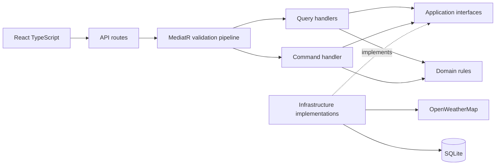

# Xtramile Weather

ASP.NET Core weather API and a separate React TypeScript client for the Xtramile practical assessment. Select a country/city, inspect current weather, and save a persistent weather note. Weather comes from OpenWeatherMap; the default automated tests use synthetic responses and require no API key.

## How to run the weather app

Choose **Docker** to run the complete app, or **local development** to run the backend and React separately. The commands below use PowerShell. Open your terminal in the repository root, where `compose.yaml` and `WeatherApp.slnx` are located.

For a fresh checkout:

```powershell
git clone https://github.com/i4ba1/weather-app.git
cd weather-app
```

### Option A: run with Docker

You need Docker Desktop running with Linux containers. Local .NET and Node installations are not required for this option.

**1. Create the configuration file without overwriting an existing one:**

```powershell
if (-not (Test-Path .env)) { Copy-Item .env.example .env }
```

**2. Open `.env` in your editor and set your OpenWeatherMap key:**

```dotenv
OPENWEATHERMAP_API_KEY=your_actual_key_here
```

See [API key setup](#get-and-configure-an-openweathermap-key) if you do not have a key. Keep the actual key in the ignored `.env` file.

**3. Build and start the complete app:**

```powershell
docker compose up --build -d
docker compose ps
```

**4. Open [http://localhost:8080](http://localhost:8080).** Choose a country, then a city, to load weather. Enter an observation and click **Save note**.

React, the API, and the embedded SQLite database run in one application container. The named volume preserves notes. To view startup logs, use `docker compose logs --tail 100 weather`. To stop the app while retaining notes, use `docker compose down` without `--volumes`.

### Option B: run locally in two terminals

You need **.NET SDK 10**, **Node.js 22.12 or newer compatible release** (Node 22 recommended), and npm.

**Terminal 1 — backend, from the repository root:**

```powershell
dotnet restore WeatherApp.slnx
$env:OpenWeatherMap__ApiKey = 'your_actual_key_here'
dotnet run --project src/WeatherApp --launch-profile http
```

The backend listens on [http://localhost:5000](http://localhost:5000). Its country API is [http://localhost:5000/api/countries](http://localhost:5000/api/countries). Leave this terminal running. Native development uses the environment variable above; it does not automatically load Docker's `.env` file.

**Terminal 2 — frontend, starting from the repository root:**

```powershell
cd frontend
npm ci
npm run dev
```

**Open [http://localhost:5173](http://localhost:5173).** Vite forwards `/api` calls to the backend on port 5000. Leave both terminals running; press **Ctrl+C** in each to stop them. Playwright browser installation is needed for browser tests, not for simply running the app.

Without an active provider key, country/city selection and saving notes still work, but live weather returns a configuration/provider error. More details: [setup](#prerequisites-and-setup), [local persistence](#run-locally), [production deployment](#production-build-and-docker), and [tests](#automated-testing).

## Channel refresh demonstration


Recorded on 12 October 2026 using visible Chromium. Every browser API request goes through React/Vite to the real ASP.NET Core API, MediatR handlers, channel workers and isolated SQLite. Only the backend's outbound provider HTTP transport is replaced with synthetic fixtures; the banner labels the weather as sample data. No browser API responses are mocked and no live provider calls are made.

The test passed: weather returned 200, note creation returned 201, refresh submission returned 202, and polling returned 200. Jakarta completed in one attempt; Bandung retried a simulated 503 and completed in two attempts; Surabaya failed after a simulated permanent 401, with no weather snapshot. Reloading restored job tracking. One note and one three-city job were independently verified in the isolated database.

See [sample data](frontend/recording/channels-sample-data.json) and [recording instructions](#record-the-channel-workflow-with-the-real-api). The GIF is stored under `docs/media/` for display in repository checkouts and on GitHub after committing; the MP4, trace, screenshots, reports and sample database remain ignored local artifacts.

## Live workflow demonstration


Recorded on 4 October 2026 with visible Chromium. The browser calls the React development server, which proxies API requests to ASP.NET Core. The backend retrieves live weather from OpenWeatherMap and persists the note in SQLite. No API responses were mocked in this recording; the weather shown reflects the recording time.

The Playwright run passed: country/city/weather requests returned 200, note creation returned 201, and changing country cleared the previous city and weather. The created note was independently verified in SQLite. A separate Docker smoke check verified that a note survived container replacement using the named volume.

See [recording instructions](#record-a-workflow-against-the-running-backend) to reproduce the demo. The GIF is included in `docs/media/` so it displays from a repository checkout or on GitHub; full reports, traces and MP4 files remain local under `artifacts/`.

## Architecture and CQRS decoupling

For the complete code walkthrough, OOP/pattern explanations, and Technical Lead interview practice, see the [technical walkthrough and interview guide](docs/technical-walkthrough-and-interview-guide.md).

For request-flow diagrams, every `Program.cs` line, and the classes called before a response is returned, see [API request lifecycle and Program.cs explained](docs/api-request-lifecycle-and-program-explained.md).

The backend follows **Onion Architecture**: Domain contains the core rules, Application defines use cases and interfaces, and Infrastructure implements those interfaces. Dependencies point toward the core. API composes the layers and dispatches requests through MediatR; dependency injection selects concrete infrastructure implementations at startup.

Backend layers are folders inside `src/WeatherApp/`, as requested for AI-assisted assessment implementations:

| Folder | Responsibility | Dependencies |
| --- | --- | --- |
| Domain | Temperature conversion, weather-note entity and rules | .NET base library only |
| Application | Commands, queries, DTOs, validators, handlers, interfaces | Domain, MediatR, FluentValidation |
| Infrastructure | SQLite/EF Core persistence, bundled locations, OpenWeatherMap HTTP adapter | Application, Domain |
| API | Thin routes, Problem Details, composition root | Application; Infrastructure only for registration |
| frontend | React TypeScript, API client, component and browser tests | HTTP contracts |



CQRS separates read requests from state-changing requests. `GET /api/weather/Jakarta?countryCode=ID` sends `GetWeatherQuery`; validation checks the input, its handler resolves the catalog location and uses `IWeatherService`. The infrastructure adapter fetches imperial weather, converts Fahrenheit to Celsius through Domain, and returns `WeatherDto`. The endpoint never calls HttpClient or EF Core directly.

`POST /api/weather/notes` sends `CreateWeatherNoteCommand`; FluentValidation rejects invalid payloads before the handler runs. The handler constructs a Domain note and calls `IWeatherNoteRepository`. Its EF Core implementation awaits `SaveChangesAsync` before returning an identifier. Application interfaces allow tests to replace external concerns without changing handlers. This design uses one database; CQRS does not introduce separate databases, event sourcing, or a broker. Every EF Core read in the test/verification paths explicitly uses `AsNoTracking()`; runtime catalog/weather reads are not database reads.

## Prerequisites and setup

- .NET SDK 10, Node.js 22.12 or newer compatible release (Node 22 recommended), npm.
- Docker Desktop/Engine with Linux containers for container delivery; native development also works.
- An OpenWeatherMap key with access to the Current Weather API for live weather.

From the repository root:

```powershell
dotnet restore WeatherApp.slnx
cd frontend
npm ci
npx playwright install chromium
cd ..
```

For Linux browser-test setup, use `npx playwright install --with-deps chromium`. Installation downloads dependencies/browser binaries; the default test suite does not call external services. The optional live recording requires internet access and an active API key.

### Get and configure an OpenWeatherMap key

1. [Create an account](https://home.openweathermap.org/users/sign_up) and verify your email.
2. Copy the complete key from your account's [API keys page](https://home.openweathermap.org/api_keys). Activation can take up to two hours, according to the [OpenWeather FAQ](https://openweathermap.org/faq).
3. For Docker, put `OPENWEATHERMAP_API_KEY=your-key` in the root `.env` file. For native development, set `OpenWeatherMap__ApiKey` in the backend terminal as shown below. Native `dotnet run` does not automatically load `.env`.

This app uses the Current Weather endpoint (`/data/2.5/weather`). Keep the key in backend configuration; `.env` is ignored by Git. After editing the Docker key, run `docker compose up -d --force-recreate` to apply it without rebuilding the image or deleting the database volume.

If weather returns 503, the backend key is missing. A 502 indicates a provider error or rejected response; an inactive or invalid key can cause this. Check the key and its activation status before retrying. A 504 indicates a provider timeout.

## Run locally

Set the server key through an environment variable in the backend terminal:

```powershell
$env:OpenWeatherMap__ApiKey = 'your-key'
dotnet run --project src/WeatherApp --launch-profile http
```

In a second terminal:

```powershell
cd frontend
npm run dev
```

Open http://localhost:5173. Vite proxies `/api` to http://localhost:5000. The key stays on the server; never put it in a `VITE_*` variable. Without a key, countries/cities and notes work; weather returns a clear 503 configuration error. No fake weather fallback is enabled.

The default SQLite file is `src/WeatherApp/data/weather.db` in native development. Override `ConnectionStrings__Weather` with a SQLite connection string to change it. Relative paths resolve against the backend content root. Startup creates the directory and initializes new databases with `EnsureCreated`. `WeatherDatabaseInitializer` adds refresh tables and indexes idempotently to existing databases, preserving Notes. Future schema changes need an explicit upgrade or migration strategy. Notes, refresh jobs, and successful weather snapshots survive process restarts. Use one application instance per SQLite database; distributed consumers require a different recovery/claim design.

`WeatherDbContext` is registered through `AddDbContext` with a scoped lifetime, and the note repository is scoped too. Each API request receives its own context. Adding a note marks it as Added in EF Core's change tracker; the command awaits `SaveChangesAsync` before reporting success. Read verification uses `AsNoTracking()` to avoid tracking entities that will not be changed. UI selection and feedback state stay in React; persisted notes stay in SQLite.

## Production build and Docker

```powershell
if (-not (Test-Path .env)) { Copy-Item .env.example .env }
# Edit .env to set OPENWEATHERMAP_API_KEY, then:
docker compose up --build -d
```

Open http://localhost:8080. The multi-stage image builds React and .NET, serves the React build and `/api` from one nonroot application container, and stores SQLite at `/app/data/weather.db`. The `weather-data` volume persists notes across container replacement. `docker compose down` retains the volume; adding `--volumes` deletes the stored notes. Runtime environment variables carry the key; it is not included in the image. Frontend source remains in `frontend/`.

For a native production deployment:

```powershell
cd frontend
npm run build
cd ..
dotnet publish src/WeatherApp -c Release -o artifacts/app
New-Item -ItemType Directory -Force artifacts/app/wwwroot
Copy-Item -Recurse frontend/dist/* artifacts/app/wwwroot/
dotnet artifacts/app/WeatherApp.dll --contentRoot "$PWD/artifacts/app" --urls http://localhost:8080
```

Unknown `/api` routes return JSON Problem Details rather than the React document. Frontend history paths fall back to the built index document.

## API contracts

### Test the API with Postman

Import these files into Postman using **Import → Files**:

- [API collection](docs/postman/Xtramile-Weather.postman_collection.json)
- [Docker environment — localhost:8080](docs/postman/Xtramile-Weather-Docker.postman_environment.json)
- [Native environment — localhost:5000](docs/postman/Xtramile-Weather-Native.postman_environment.json)

Start the app using the instructions above, select the matching environment in Postman, then open **Xtramile Weather API → API workflow**. Send the catalog, weather, note, and refresh requests in order. **Create refresh job** captures `refreshJobId`; repeat **Get refresh job** to observe completion. View assertions under the request's test results. The **Validation and error examples** folder contains expected 400/404 cases; their assertions pass when the API correctly rejects those requests.

The collection defaults to Indonesia/Jakarta. Edit its collection variables to change `countryCode`, `cityName`, or `noteText`. Environment `baseUrl` overrides the collection default. The note pre-request script builds its JSON body safely from those variables, and a successful save stores `createdNoteId` and `createdNoteAtUtc` in collection variables. There is no note-read endpoint; each successful note POST creates a real SQLite row.

Live weather requires an active OpenWeatherMap key configured on the backend. Do not add that key to Postman. If weather returns 502/503/504, inspect the response and backend configuration; the weather request deliberately expects 200 and will show a failed test. You can still send catalog/note requests without weather success. These Postman checks run only when you send requests or explicitly run the collection; they are separate from the offline automated suite.

### Endpoints

| Method and route | Behavior |
| --- | --- |
| GET `/api/countries` | All countries available in the bundled catalog |
| GET `/api/countries/{countryCode}/cities` | All available cities for that country |
| GET `/api/weather/{cityName}?countryCode=ID` | Current weather for the selected city/country |
| POST `/api/weather/notes` | Persist a note; return 201 with its identifier and UTC creation time |
| POST `/api/weather/refresh-jobs` | Persist a multi-city job; return 202 `{id}` and a Location header |
| GET `/api/weather/refresh-jobs/{id}` | Read persisted progress, per-city results and safe failures; unknown job returns 404 |

Country codes and city selections are case-insensitive and resolve to canonical catalog values. The catalog deliberately covers Indonesia (Jakarta, Bandung, Surabaya), Australia (Sydney, Melbourne, Brisbane), Singapore, Japan (Tokyo, Osaka, Kyoto), and United Kingdom (London, Manchester, Birmingham). It is not an exhaustive worldwide city database. Extend `Infrastructure/Locations/BundledLocationCatalog.cs` and its coverage tests to add locations.

### Background refresh with Channels

In React, choose a country and click **Refresh all cities**. Progress appears below the main weather dashboard. Successful snapshots show their provider observation times; failed cities show an error without fabricated readings. The last job ID is kept in browser localStorage so reloads resume tracking. **Dismiss tracking** clears that browser reference and stops polling; accepted server work continues.

You can also submit a batch directly:

```http
POST /api/weather/refresh-jobs
Content-Type: application/json

{"cities":[{"cityName":"Jakarta","countryCode":"ID"},{"cityName":"Bandung","countryCode":"ID"}]}
```

The batch must contain 1–13 distinct supported cities. Poll the Location URL returned with 202. Job statuses are `Pending`, `Running`, `Completed`, `Failed`, or `CompletedWithErrors`; per-city statuses use the first four. Each city includes `attempts`, nullable `weather`, and nullable `error`. Status queries explicitly use `AsNoTracking` and never update work.

SQLite is the durable job store. A dispatcher feeds due per-city IDs into a bounded `Channel<Guid>`; two scoped workers call `IWeatherService` concurrently. The queue waits when full and deduplicates queued/executing IDs. Startup recovers interrupted work, and a two-minute lease recovers work stranded by persistence faults during operation. Completed snapshots are retained. Delivery is at least once: a crash can repeat a read-only provider call. This recovery design assumes one application instance per database.

Configure these values in `appsettings.json` or environment variables such as `WeatherRefresh__Workers`:

| Setting under `WeatherRefresh` | Default | Purpose |
| --- | --- | --- |
| `Capacity` | 20 | Maximum queued IDs |
| `Workers` | 2 | Concurrent refresh consumers, each with its own DI scope/DbContext |
| `MaxAttempts` | 3 | Total attempts per city, including interrupted attempts |
| `DispatcherIntervalMilliseconds` | 1000 | Discover persisted pending work |
| `ProviderIntervalMilliseconds` | 1000 | Minimum spacing between background provider call starts |
| `RetryBaseMilliseconds` | 2000 | Exponential retry delay: 2 seconds, then 4 seconds by default |

Timeouts, network failures, HTTP 408/429 and 5xx retry within the attempt limit. Missing configuration, permanent HTTP failures and malformed payloads fail immediately. Set pacing for your provider allowance; direct single-city requests remain outside this background limiter. Jobs/results accumulate until explicitly removed; automatic retention is not implemented. The existing Docker volume stores both notes and jobs—no extra container is required.

See [the channel workflow and recovery design](docs/weather-refresh-channels.md) for diagrams, class responsibilities and verification details.

Note request:

```json
{"cityName":"Jakarta","countryCode":"ID","text":"Warm and breezy today."}
```

Created response (example identifiers):

```json
{"id":"d1bbbc3c-f100-44e5-b919-a540f1124551","createdAtUtc":"2026-10-04T07:00:00+00:00"}
```

Weather response (illustrative values, not live readings):

```json
{
  "city":"Jakarta","countryCode":"ID","observedAtUtc":"2023-11-14T22:13:20+00:00",
  "windSpeedMetersPerSecond":4.4704,"windDirectionDegrees":180,
  "visibilityMeters":10000,"pressureHpa":1013,"skyConditions":"Clear",
  "temperatureFahrenheit":68,"temperatureCelsius":20,
  "dewPointCelsius":9.255,"dewPointIsCalculated":true,"relativeHumidityPercent":50
}
```

OpenWeatherMap is requested with imperial units. Wind mph is converted to m/s, visibility is meters, pressure is hPa, direction is degrees, and observation times are UTC. A missing wind direction is represented as 0 only for calm wind. Dew point uses the Magnus approximation (17.62 and 243.12) from Celsius temperature and humidity because the current-weather payload does not provide it; the UI labels it calculated. At zero humidity dew point is null/unavailable. Malformed or impossible upstream metrics are rejected.

Notes require a catalog city, two-letter country code, and trimmed nonblank text up to 2,000 characters. Statuses: 400 invalid input/JSON; 404 unknown catalog location or route; 502 provider failures/invalid payload; 503 missing provider configuration; 504 provider timeout; 500 unexpected errors with a generic response. Provider timeout is 10 seconds, caller cancellation propagates, and provider request logging is disabled because its URI contains the key. There is no note-read endpoint; POST returns the stored identifier without advertising a nonexistent resource URL. Authentication/user-owned notes are outside this assessment scope.

Changing the selected city cancels the client request and clears old save feedback. It does not undo a note already accepted and persisted by the server for the original selection.

## Automated testing

```powershell
dotnet build WeatherApp.slnx -c Release
dotnet test WeatherApp.slnx -c Release
cd frontend
npm run lint
npm run test -- --run
npm run build
npm run test:e2e
```

Or run `./scripts/verify.ps1` from the root after setup. Use `./scripts/verify.ps1 -InstallDependencies` for setup and verification together. The script stops on any failed command.

- Domain xUnit tests cover freezing, boiling, negative and fractional Fahrenheit conversion, and note invariants.
- Query-handler tests isolate the catalog/weather interfaces, including selection resolution and cancellation.
- Command-handler tests use unique EF Core In-Memory stores and fresh contexts to verify actual persisted state and rejected writes.
- WebApplicationFactory tests use isolated SQLite and fake weather to exercise routes, DTOs, created identifiers, validation and provider errors.
- Adapter tests use fake HttpMessageHandler responses for payload parsing, metric mapping, dew point, malformed payloads, failure statuses, timeout and missing configuration.
- Vitest/React Testing Library tests use mocked fetch for metrics, saves, errors, selection resets, duplicate saves and stale requests.
- Default Playwright tests intercept all API calls and cover the complete browser workflow and error feedback.

The default automated suite and CI do not contact live OpenWeatherMap and need no API key. GitHub Actions installs dependencies, runs the same checks, validates Compose and builds the Docker image. Dependency/image setup uses the network; default tests use only local/fake services. The opt-in live recording below calls OpenWeatherMap and is run separately.

### Record a workflow against the running backend

Review `frontend/recording/sample-data.json` before running the recording. It supplies synthetic Jakarta weather and the note text. The recording intercepts only the weather response; country/city requests and note creation use the actual backend and SQLite. A visible banner labels the synthetic weather.

Start the backend on port 5000 and Vite on port 5173 using the local instructions above. For recording, set an isolated SQLite database in the backend terminal before starting it. From the repository root:

```powershell
$recordingDb = Join-Path $PWD 'artifacts/e2e/sample.db'
$env:ConnectionStrings__Weather = "Data Source=$recordingDb"
dotnet run --project src/WeatherApp --launch-profile http
```

```powershell
cd frontend
npm run test:e2e:record
cd ..
python -m pip install --target .superpowers/video-tools imageio-ffmpeg==0.6.0
python scripts/convert-e2e-video.py
```

The test verifies weather metrics, a real 201 note response, and country selection reset. Each run creates a note in the selected database. Artifacts under `artifacts/e2e/` include the HTML report, trace, source WebM, created-note JSON, screenshot, `weather-workflow.mp4`, and `weather-workflow.gif`. The converter also accepts `--ffmpeg <path>` to use an existing FFmpeg installation. These local artifacts are ignored by Git.

For an explicitly requested live smoke recording, start both services and configure an active backend API key, then run these commands. This separate configuration opens visible Chromium, makes real provider calls, and creates a timestamped note; it is excluded from the offline test configurations and CI.

```powershell
cd frontend
npx playwright test --config playwright.live.config.ts --headed
cd ..
python scripts/convert-e2e-video.py --artifact-dir artifacts/live-e2e
```

Live recordings, API status evidence, weather JSON and note acknowledgement are saved under `artifacts/live-e2e/`. They contain no provider key. Python and FFmpeg (or the workspace-local `imageio-ffmpeg` installation above) are needed only for conversion. To inspect the interactive report, run `npx playwright show-report ../artifacts/live-e2e/report` from `frontend/`.

To update the embedded demo after a successful recording, copy `artifacts/live-e2e/weather-workflow.gif` to `docs/media/weather-workflow.gif`.

### Record the channel workflow with the real API

Review [channels-sample-data.json](frontend/recording/channels-sample-data.json) first. This separate recording configuration starts the production API entry point on loopback port 5105 through a test-only Kestrel host, and React/Vite on port 5175. It opens visible Chromium and records the UI. Both ports must be free. It uses a new database under `artifacts/channels-e2e/` for each run; your native and Docker databases are untouched. No provider key is required.

After installing the normal development dependencies and Playwright Chromium:

```powershell
cd frontend
npm run test:e2e:channels
cd ..
python scripts/convert-e2e-video.py --artifact-dir artifacts/channels-e2e
Copy-Item artifacts/channels-e2e/weather-workflow.gif docs/media/weather-refresh-workflow.gif
```

The converter requires Python and FFmpeg; use the `imageio-ffmpeg` installation shown above or pass `--ffmpeg <path>`. The test-only [recording host](tests/WeatherApp.RecordingHost/RecordingEntryPoint.cs) keeps the real weather adapter and replaces its HTTP message handler, so validation, provider mapping, transient-error classification, concurrent workers and persistence execute normally. This host is excluded from the Docker image.

Artifacts include `weather-workflow.mp4`, `weather-workflow.gif`, the source WebM, a full-page completion screenshot, trace, HTML/JSON reports, and `verified-api-results.json`. `sample-database.txt` identifies the isolated SQLite file. To inspect the report:

```powershell
cd frontend
npx playwright show-report ../artifacts/channels-e2e/report
```

The default headless suite remains `npm run test:e2e`; the headed recording is opt-in and separate from CI.

## AI tooling

Root `AGENTS.md` defines architectural dependency boundaries, CQRS patterns, naming conventions, validation/persistence placement, strict TypeScript, offline testing, and secret handling. The approved spec and task plan live in `docs/superpowers/`. Superpowers executing-plans applies test-first implementation and verification checkpoints; the ignored `.superpowers/` ledger tracks local progress. Codex implements the files and runs the actual checks; these instructions supplement the code and tests.

Codex automatically reads the repository-root `AGENTS.md` as project instructions when working in this checkout. Edit that file to change the project's AI guidance; no API key or prompt-file path setting is required. The explicitly requested live smoke recording is an exception to the offline testing rule and remains separate from default tests and CI.

Dependencies are pinned in csproj/package.json and package-lock.json. MediatR 12.5.0 uses its Apache 2.0 license; the newer commercial release line is not required for this assessment. EF Core is pinned to 10.0.12; SQLitePCLRaw bundle 3.0.5 replaces the vulnerable native dependency found during setup.

## Deliverables

Repository contents include backend, separate frontend, all tests, root AI instructions, Docker/Compose files, CI workflow, and this README. The README covers architecture/CQRS decoupling, setup/build/run/testing, EF Core state management, design decisions, and AI configuration. GitHub publication is a separate authorized operation requiring a target repository; this local implementation does not publish automatically.

### Repository metadata

- **Name/title:** `xtramile-weather-app`
- **Description:** Weather app built with ASP.NET Core, React TypeScript, Onion Architecture, CQRS, EF Core SQLite, Docker, and Playwright testing.
- **Topics:** `weather-app`, `aspnet-core`, `dotnet`, `react`, `typescript`, `onion-architecture`, `cqrs`, `mediatr`, `entity-framework-core`, `sqlite`, `docker`, `playwright`.
- **Initial release tag:** `v1.0.0`.

## Contributor

[Muhamad Nizar Iqbal (@i4ba1)](https://github.com/i4ba1)
