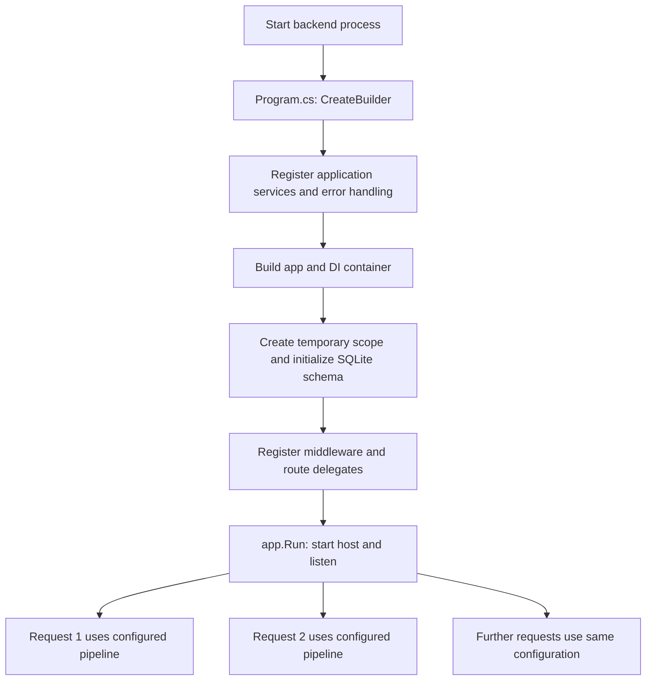
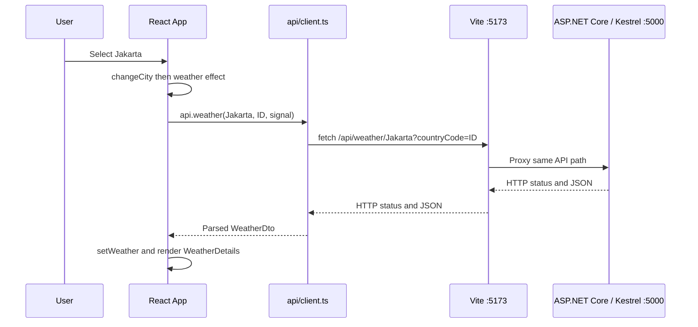
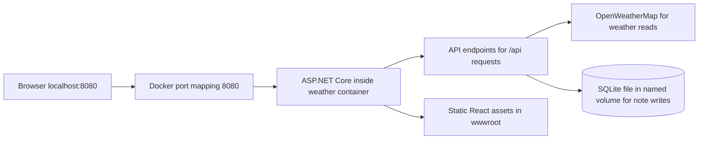
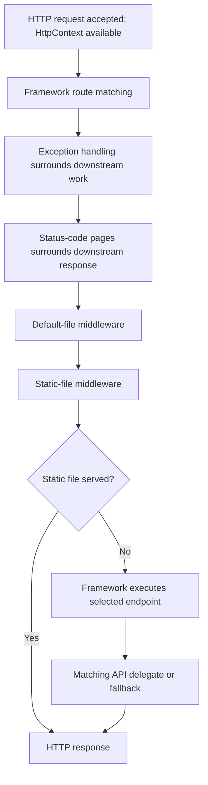
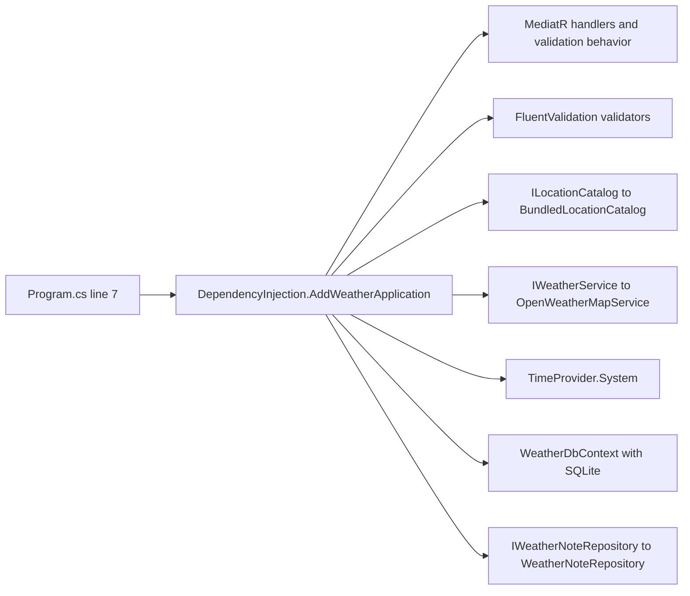
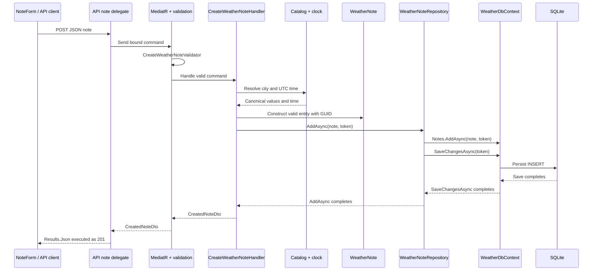
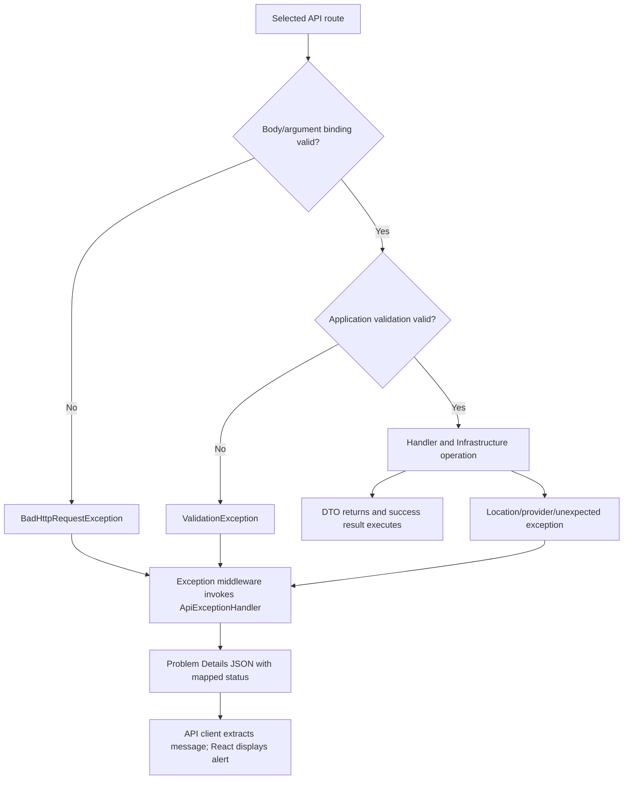

# How an API request enters .NET: Program.cs and the response lifecycle

Prepared on **7 October 2026** from this project's `Program.cs` and its called classes at baseline `33d8e55`. This document focuses on execution order. For architecture/OOP and interview preparation, see the [technical walkthrough](technical-walkthrough-and-interview-guide.md).

## Contents

1. [The main distinction: startup versus requests](#1-the-main-distinction-startup-versus-requests)
2. [How the browser reaches .NET](#2-how-the-browser-reaches-net)
3. [Program.cs: complete code and every line explained](#3-programcs-complete-code-and-every-line-explained)
4. [What AddWeatherApplication registers](#4-what-addweatherapplication-registers)
5. [How an API endpoint is selected and its arguments are filled](#5-how-an-api-endpoint-is-selected-and-its-arguments-are-filled)
6. [Weather request: every application class in the chain](#6-weather-request-every-application-class-in-the-chain)
7. [Save-note request: every application class in the chain](#7-save-note-request-every-application-class-in-the-chain)
8. [Countries and cities: the shorter chains](#8-countries-and-cities-the-shorter-chains)
9. [Errors, unknown routes and frontend files](#9-errors-unknown-routes-and-frontend-files)
10. [Where to put breakpoints and how to explain the flow](#10-where-to-put-breakpoints-and-how-to-explain-the-flow)

## 1. The main distinction: startup versus requests

**Program.cs configures the application once for each process startup. It is not executed again from line 1 for each request.**

There are two phases:

| Phase | Trigger | Main work |
| --- | --- | --- |
| Startup | `dotnet run`, running the published DLL, or starting the container | Create host, register dependencies, initialize database, configure middleware and endpoints, start listening |
| Request handling | Browser/fetch sends HTTP to a running server | Create request context, route request, bind arguments, execute handler, write HTTP response |

Some lines register callbacks that execute later. For example, calling `MapFallback` happens at startup; the lambda passed to it runs only when a matching request reaches that fallback. The same distinction applies to route delegates in `Endpoints.cs` and the callback supplied to `UseStatusCodePages`.



Requests may overlap. Each request has its own `HttpContext`; scoped dependencies such as `WeatherDbContext` belong to a scope rather than a global reusable context. Shared singletons are a different lifetime.

## 2. How the browser reaches .NET

### 2.1 Native development: Vite is a proxy

Suppose you choose **Indonesia → Jakarta** in the frontend at localhost:5173.

1. `LocationSelector` calls the change callback supplied by `App`.
2. `App.changeCity` changes the selected city and clears old weather.
3. The weather `useEffect` observes the new city/country.
4. It calls `api.weather(city, country, controller.signal)`.
5. The generic `request<T>` helper calls browser `fetch` using a relative `/api/...` URL.
6. Vite proxies `/api` to the running backend at localhost:5000, as configured in `vite.config.ts`.
7. ASP.NET Core's HTTP server, normally Kestrel in this setup, receives the request and passes it to the configured application pipeline.



The browser is not calling the provider directly. OpenWeatherMap is contacted later by the backend adapter. No provider key is added to the browser's URL.

### 2.2 Docker: one origin, no Vite at runtime



The Docker build uses Node/Vite to produce React assets, but the runtime image serves those assets through ASP.NET Core. Requests to localhost:8080/api reach the backend directly through Docker's port mapping.

Key files: [App.tsx](../frontend/src/App.tsx), [API client](../frontend/src/api/client.ts), [Vite configuration](../frontend/vite.config.ts), [Dockerfile](../Dockerfile), [Compose](../compose.yaml).

## 3. Program.cs: complete code and every line explained

Source: [src/WeatherApp/Program.cs](../src/WeatherApp/Program.cs). Line numbers below refer to the actual 35-line file, including blank lines. The following block is its code, without added numbering:

```csharp
using Microsoft.EntityFrameworkCore;
using WeatherApp.API;
using WeatherApp.Infrastructure;
using WeatherApp.Infrastructure.Persistence;

var builder = WebApplication.CreateBuilder(args);
builder.Services.AddWeatherApplication(builder.Configuration, builder.Environment);
builder.Services.AddProblemDetails();
builder.Services.AddExceptionHandler<ApiExceptionHandler>();
builder.Services.Configure<RouteHandlerOptions>(options => options.ThrowOnBadRequest = true);
var app = builder.Build();

using (var scope = app.Services.CreateScope())
    await scope.ServiceProvider.GetRequiredService<WeatherDbContext>().Database.EnsureCreatedAsync();

app.UseExceptionHandler();
app.UseStatusCodePages(async context =>
    await Results.Problem(statusCode: context.HttpContext.Response.StatusCode).ExecuteAsync(context.HttpContext));
app.UseDefaultFiles();
app.UseStaticFiles();
app.MapWeatherEndpoints();
app.MapFallback(async context =>
{
    var frontend = Path.Combine(app.Environment.WebRootPath ?? Path.Combine(app.Environment.ContentRootPath, "wwwroot"), "index.html");
    if (context.Request.Path.StartsWithSegments("/api") || !HttpMethods.IsGet(context.Request.Method) || !File.Exists(frontend))
    {
        await Results.Problem(statusCode: 404, title: "Resource not found").ExecuteAsync(context);
        return;
    }
    context.Response.ContentType = "text/html";
    await context.Response.SendFileAsync(frontend);
});
app.Run();

public partial class Program;
```

### 3.1 Lines 1–11: imports, service registration and host construction

| Line | Exact purpose |
| --- | --- |
| **1** | Imports EF Core's namespace so database extension methods such as `EnsureCreatedAsync` are available. It does not connect to the database. |
| **2** | Imports our API namespace so `ApiExceptionHandler` and the `MapWeatherEndpoints` extension are available. |
| **3** | Imports Infrastructure so `AddWeatherApplication` can be called. This is the composition root choosing outer-layer implementations. |
| **4** | Imports Persistence so `WeatherDbContext` can be referenced during startup initialization. |
| **5** | Blank line separating imports from executable startup statements. |
| **6** | Creates `WebApplicationBuilder` using command-line arguments and standard host/configuration defaults. `builder.Configuration` supplies configuration; `builder.Environment` supplies environment/content-root information; `builder.Services` is the dependency-registration collection. |
| **7** | Calls our extension in `Infrastructure/DependencyInjection.cs`. Registers MediatR, validation, catalog, clock, provider client/options, EF context and repository. It records how services will be supplied; it does not fetch weather or save a note. Its connection setup can create the data directory. |
| **8** | Registers framework Problem Details support for structured error responses. This is registration, not a per-request exception catch. Our explicit `Results.Problem` calls write the project's error responses. |
| **9** | Registers `ApiExceptionHandler` as an exception-handler service. Its `TryHandleAsync` executes later when exception middleware invokes it. |
| **10** | Configures minimal-API route-handler behavior to throw on bad binding requests. Malformed parameters/body can then be translated by centralized error handling into JSON 400 responses. This is separate from FluentValidation of a successfully bound request. |
| **11** | Builds the `WebApplication` and its service provider from the registrations. We now have `app.Services` and can configure the pipeline. Building is not the same as starting the listening server; `Run` does that later. |

`using Namespace;` means “make these types/extension methods available by short names.” It is different from the resource-lifetime `using (...)` at line 13.

### 3.2 Lines 12–14: initialize the database before listening

| Line | Exact purpose |
| --- | --- |
| **12** | Blank separator. |
| **13** | Creates a temporary DI scope. Because `WeatherDbContext` is scoped, resolve it inside a scope rather than keep it globally. The scope is disposed after the single following statement completes, including its awaited work. |
| **14** | Resolves `WeatherDbContext`, accesses EF's `Database` facade and awaits schema/database creation if needed. This is startup infrastructure work; it is not routed through a command and is not executed for every HTTP request. |

There are no braces after line 13 because its body is exactly one statement at line 14. The `using` scope still disposes correctly. `EnsureCreatedAsync` initializes a missing database/schema; it does not apply migrations to an existing schema. If startup initialization fails, execution does not reach `app.Run` and the app cannot serve requests normally.

### 3.3 Lines 15–21: register middleware and API routes

| Line | Exact purpose |
| --- | --- |
| **15** | Blank separator. |
| **16** | Adds exception-handling middleware. During a request, it can catch exceptions from downstream work and invoke the registered `ApiExceptionHandler`. Registration at line 9 and pipeline activation at line 16 serve different purposes. |
| **17** | Starts a status-code-pages registration with an async callback. It handles suitable error-status responses that otherwise have no body. The lambda is registered now and executed later only when needed. |
| **18** | Callback creates a Problem Details result using the response's existing status code and executes it against that request's `HttpContext`. It does not normally overwrite an error body already written by `ApiExceptionHandler`. |
| **19** | Adds default-file middleware, which can rewrite a suitable directory request to a default document path when no endpoint delegate is already selected. It does not itself send the file. In this pipeline, routing selects the fallback for `/`, so this middleware skips that root request. |
| **20** | Adds static-file middleware that can serve existing frontend files from the web root when no endpoint delegate is selected, such as a matching `.js` asset. A served asset can finish the request without entering any MediatR handler. |
| **21** | Calls `Endpoints.MapWeatherEndpoints`. That extension registers the four API route patterns/delegates. It does not execute all four handlers now. |

**Middleware** is work surrounding request handling; it can inspect the request, invoke the next stage, inspect the response, or finish early. **An endpoint** is the selected route's final handler. `Use...` adds middleware; `MapGet/MapPost/...` describes endpoints. Do not interpret every `Map...` line as an immediate per-request class call.

Minimal-hosting `WebApplication` supplies endpoint routing/execution when endpoints are registered, even though this file has no explicit `UseRouting`/`UseEndpoints` calls. The diagram below shows the main API path, including those framework-provided stages; it omits conditional framework middleware unrelated to this explanation. [Microsoft: WebApplication middleware configuration](https://learn.microsoft.com/en-us/aspnet/core/fundamentals/minimal-apis/webapplication?view=aspnetcore-10.0).



Middleware unwinds after downstream execution, so response handling is not just a one-way list. Exceptions can travel back to exception handling, and status-code pages inspect the resulting response. For an ordinary API call, static-file/default-file handling does not supply the business response.

Both file middleware check whether routing already selected an endpoint delegate. Consequently, `/` reaches the selected fallback and its `SendFileAsync`, while existing file-style assets without a matching endpoint can be served by static middleware. This ordering is confirmed by the framework implementation: [DefaultFilesMiddleware](https://github.com/dotnet/aspnetcore/blob/v10.0.0/src/Middleware/StaticFiles/src/DefaultFilesMiddleware.cs#L46), [StaticFileMiddleware](https://github.com/dotnet/aspnetcore/blob/v10.0.0/src/Middleware/StaticFiles/src/StaticFileMiddleware.cs#L79).

### 3.4 Lines 22–32: register a fallback endpoint

| Line | Exact purpose |
| --- | --- |
| **22** | Registers a lowest-priority fallback endpoint with an async request delegate. The body runs for matching fallback requests, not immediately at startup. |
| **23** | Opens the callback body. `context` is the current request's `HttpContext`, not a DbContext. |
| **24** | Calculates the React index path: configured `WebRootPath` if available; otherwise `ContentRootPath/wwwroot`; then appends `index.html`. `??` means use the right operand only when the left is null. |
| **25** | Checks three refusal conditions: path belongs to `/api`, method is not GET, or frontend index is missing. `||` means any one is enough. These checks apply after the fallback is selected. |
| **26** | Opens the refusal block. |
| **27** | Writes JSON Problem Details with 404 and title `Resource not found`. An unknown API should not be represented as a successful frontend page. |
| **28** | Returns from this request delegate, preventing the HTML file-send branch. It does not stop the backend process. |
| **29** | Closes the refusal block. |
| **30** | Sets the successful fallback response content type to `text/html`. |
| **31** | Asynchronously sends the index file to the client. This is SPA document delivery, not a weather API response. |
| **32** | Closes the callback and completes the fallback registration. |

Important framework detail: this `MapFallback` overload matches **non-file-style paths** with the lowest priority. A missing file-style URL such as `/missing.js` is not promised the SPA index by this fallback; it can result in an ordinary 404. Normal matching API routes win over fallback. [Microsoft: MapFallback](https://learn.microsoft.com/en-us/dotnet/api/microsoft.aspnetcore.builder.fallbackendpointroutebuilderextensions.mapfallback?view=aspnetcore-10.0).

### 3.5 Lines 33–35: run the host and expose its test entrypoint

| Line | Exact purpose |
| --- | --- |
| **33** | Starts/runs the configured host and keeps it alive until shutdown. Only now can normal network requests use the configuration prepared above. It does not mean requests execute one at a time. |
| **34** | Blank separator before the type declaration. |
| **35** | Declares the public partial `Program` type for the top-level entrypoint, allowing tests to refer to `WebApplicationFactory<Program>`. This is not a controller or a method called for every request. `partial` lets the declaration cooperate with the compiler-generated top-level Program type. |

## 4. What AddWeatherApplication registers

Called by `Program.cs` line 7. Source: [DependencyInjection.cs](../src/WeatherApp/Infrastructure/DependencyInjection.cs).



| When a class asks for… | The registration supplies… | Why it matters |
| --- | --- | --- |
| `ISender` | MediatR sender | Endpoint can dispatch a request without choosing a handler manually |
| A MediatR request handler | Handler discovered in the application assembly | Request type determines which handler executes |
| `IEnumerable<IValidator<TRequest>>` | Registered validators for that request | Pipeline behavior can validate without endpoint-specific validation code |
| `ILocationCatalog` | Singleton `BundledLocationCatalog` | Same supported locations available across use cases |
| `IWeatherService` | Typed `OpenWeatherMapService` with configured HttpClient/options | Provider details stay outside the handler |
| `TimeProvider` | Singleton system clock | Command can obtain UTC time; tests can replace it |
| `WeatherDbContext` | Scoped context configured with `UseSqlite` | Persistence participates in a scope rather than shared mutable global state |
| `IWeatherNoteRepository` | Scoped `WeatherNoteRepository` | Note handler depends on a persistence contract |

Registration does not mean every service is constructed at startup or exactly in this table order. DI resolves objects when requested. Request handling uses those registrations to construct dependency chains; the exact framework activation timing is separate from the business-operation sequence shown here.

## 5. How an API endpoint is selected and its arguments are filled

Source: [Endpoints.cs](../src/WeatherApp/API/Endpoints.cs). The app uses **Minimal APIs**, not a `WeatherController`.

`MapWeatherEndpoints(this WebApplication app)` is an extension method. The `this` parameter permits `app.MapWeatherEndpoints()` syntax. Inside, `MapGroup("/api")` establishes the shared prefix.

| Request | Registered delegate | Application request |
| --- | --- | --- |
| GET `/api/countries` | `/countries` GET lambda | `GetCountriesQuery` |
| GET `/api/countries/ID/cities` | `/countries/{countryCode}/cities` GET lambda | `GetCitiesQuery("ID")` |
| GET `/api/weather/Jakarta?countryCode=ID` | `/weather/{cityName}` GET lambda | `GetWeatherQuery("Jakarta", "ID")` |
| POST `/api/weather/notes` with JSON | `/weather/notes` POST lambda | Bound `CreateWeatherNoteCommand` |

For the weather route, this is the selected delegate:

```csharp
(string cityName, string? countryCode, ISender sender, CancellationToken token) =>
    sender.Send(new GetWeatherQuery(cityName, countryCode ?? ""), token)
```

ASP.NET Core supplies its parameters:

- `cityName` comes from `{cityName}` in the route path.
- `countryCode` comes from the query string; if missing, the lambda uses an empty string so Application validation rejects it.
- `ISender` comes from dependency injection, not the HTTP body.
- `CancellationToken` is associated with request cancellation (`HttpContext.RequestAborted`).
- For note POST, JSON body binding constructs the command before the delegate dispatches it. Bad JSON can fail at binding and never reach its FluentValidation validator.

These binding rules differ from Application validation. The framework first obtains argument values; `ValidationBehavior` later checks the dispatched request's business-input shape.

`sender.Send` invokes MediatR inside the same process. It does not create another HTTP request, send a message to a broker, or call `Program.cs` again.

## 6. Weather request: every application class in the chain

### 6.1 Ordered call trace

For `GET /api/weather/Jakarta?countryCode=ID`, after HTTP routing/binding:

| Step | Class / method | Work and next call |
| --- | --- | --- |
| 1 | `Endpoints` registered GET delegate | Creates `GetWeatherQuery` and calls `ISender.Send` |
| 2 | `ValidationBehavior<GetWeatherQuery, WeatherDto>.Handle` | Creates a validation context and invokes registered request validators |
| 3 | `GetWeatherValidator` via `ValidateAsync` | Checks city nonblank/length and two-letter country; failure stops progression |
| 4 | Validation behavior's `next(token)` | Allows the MediatR handler to execute after valid input |
| 5 | `GetWeatherHandler.Handle` | Checks cancellation and calls `ILocationCatalog.GetCities` |
| 6 | `BundledLocationCatalog.GetCities` | Supplies supported cities for that country; handler selects canonical Jakarta/ID or throws not-found |
| 7 | `OpenWeatherMapService.GetCurrentAsync` through `IWeatherService` | Checks key/cancellation, calls `HttpClient.GetAsync` for current weather |
| 8 | HTTP client / external OpenWeatherMap | Sends provider request; receives response and payload |
| 9 | `OpenWeatherMapService.Map` | Parses fields; validates values, country and sky array; calls `Number` for numeric guards |
| 10 | `Temperature.ToCelsius` | Applies Domain conversion; adapter also converts wind units and calculates dew point |
| 11 | Adapter / `WeatherDto` | Constructs DTO; completes the Task returned through handler and behavior |
| 12 | API result execution | ASP.NET Core serializes the successful returned object as JSON with HTTP 200 |
| 13 | Frontend `request<T>` | Reads JSON, checks status and resolves the expected typed result |
| 14 | `App` / `WeatherDetails` | `setWeather` causes rendering of current metrics; effect completion clears loading if still current |

These are operation steps, not a claim that DI constructs the objects in the same order. The validation behavior is generic code closed for this request/response type. The query itself is data; its handler performs the work.

### 6.2 Call-and-return sequence diagram

```mermaid
sequenceDiagram
  participant B as Browser / API client
  participant E as API weather delegate
  participant M as MediatR + ValidationBehavior
  participant V as GetWeatherValidator
  participant H as GetWeatherHandler
  participant L as BundledLocationCatalog
  participant W as OpenWeatherMapService
  participant O as OpenWeatherMap
  participant T as Temperature
  B->>E: GET weather/Jakarta?countryCode=ID
  E->>M: Send GetWeatherQuery
  M->>V: ValidateAsync
  V-->>M: No validation failures
  M->>H: Handle(request, token)
  H->>L: GetCities(ID)
  L-->>H: Catalog city list
  H->>W: GetCurrentAsync(Jakarta, ID, token)
  W->>O: HTTP weather request with server key
  O-->>W: Provider JSON
  W->>W: Parse and Map; check payload values
  W->>T: ToCelsius(fahrenheit)
  T-->>W: Celsius
  W-->>H: WeatherDto
  H-->>M: Task completes with WeatherDto
  M-->>E: WeatherDto
  E-->>B: Framework serializes DTO as 200 JSON
```

The final JSON response is **not** directly written by `GetWeatherHandler` or `Temperature`. They return values/tasks. ASP.NET Core's endpoint result execution turns the returned value into an HTTP response.

Weather reads do not use `WeatherNoteRepository` or write SQLite. `Program.cs` initialized the database at startup, but that does not imply every later request queries it.

Relevant code: [weather query/validator/handler](../src/WeatherApp/Application/Weather/GetWeather.cs), [pipeline behavior](../src/WeatherApp/Application/Common/ValidationBehavior.cs), [catalog](../src/WeatherApp/Infrastructure/Locations/BundledLocationCatalog.cs), [provider adapter](../src/WeatherApp/Infrastructure/Weather/OpenWeatherMapService.cs), [temperature rule](../src/WeatherApp/Domain/Temperature.cs), [WeatherDto](../src/WeatherApp/Application/Contracts/WeatherDto.cs).

## 7. Save-note request: every application class in the chain

The frontend note form can save for a selected supported city independently of a successful weather lookup. Example body, with illustrative user text:

```json
{"cityName":"Jakarta","countryCode":"ID","text":"Warm and breezy today."}
```

### 7.1 Ordered call trace

| Step | Class / method | Work and next call |
| --- | --- | --- |
| 1 | `NoteForm.submit` | Prevents default browser form navigation, validates nonblank text, starts pending state |
| 2 | `api.saveNote` → `request<T>` | Serializes body and sends fetch POST with JSON content type |
| 3 | ASP.NET Core route binding | Deserializes body into `CreateWeatherNoteCommand` |
| 4 | `Endpoints` registered POST delegate | Calls `sender.Send(command, token)` |
| 5 | `ValidationBehavior<CreateWeatherNoteCommand, CreatedNoteDto>.Handle` | Invokes `CreateWeatherNoteValidator`; rejects invalid input before handler progression |
| 6 | `CreateWeatherNoteHandler.Handle` | Resolves canonical city through `ILocationCatalog.GetCities` |
| 7 | `BundledLocationCatalog` and `TimeProvider` | Supplies catalog values; handler asks clock for UTC creation time |
| 8 | `WeatherNote` constructor | Enforces invariants, trims/canonicalizes entity values, assigns GUID and UTC time |
| 9 | `WeatherNoteRepository.AddAsync` through `IWeatherNoteRepository` | Adds entity to scoped context and awaits `SaveChangesAsync` |
| 10 | `WeatherDbContext` / EF Core SQLite provider | Tracks insert and writes the row into SQLite `Notes` |
| 11 | `CreateWeatherNoteHandler` | Creates `CreatedNoteDto` only after repository save returns |
| 12 | POST delegate's `Results.Json` | Constructs a response result with status 201 |
| 13 | Framework executes result | Writes JSON acknowledgement to the HTTP response |
| 14 | `request<T>` → `NoteForm` | Reads result; form shows reference ID and clears draft if request still belongs to mounted form |

### 7.2 Persistence sequence diagram



The API's success response means the save operation finished; it is not merely acknowledging that the command was queued. A canceled/lost client response does not undo a row that already committed.

Relevant code: [NoteForm](../frontend/src/components/NoteForm.tsx), [command/validator/handler](../src/WeatherApp/Application/Notes/CreateWeatherNote.cs), [Domain entity](../src/WeatherApp/Domain/WeatherNote.cs), [repository](../src/WeatherApp/Infrastructure/Persistence/WeatherNoteRepository.cs), [DbContext/model](../src/WeatherApp/Infrastructure/Persistence/WeatherDbContext.cs), [CreatedNoteDto](../src/WeatherApp/Application/Contracts/CreatedNoteDto.cs).

## 8. Countries and cities: the shorter chains

### Countries when the page loads

```text
App mount effect
  → api.countries → fetch GET /api/countries
  → API countries delegate → sender.Send(GetCountriesQuery)
  → ValidationBehavior (no registered country-query validator)
  → GetCountriesHandler.Handle
  → ILocationCatalog / BundledLocationCatalog.GetCountries
  → country DTO list returns through MediatR
  → ASP.NET Core serializes 200 JSON
  → App.setCountries → LocationSelector country options
```

There is still a validation behavior, but this parameterless query has no dedicated validator. It continues to the handler. Catalog data is already in memory, and `Task.FromResult` wraps that available result; it does not create a worker thread.

### Cities after country selection

```text
LocationSelector country callback → App.changeCountry
  → App country effect → api.cities → GET /api/countries/ID/cities
  → API cities delegate → GetCitiesQuery
  → ValidationBehavior → GetCitiesValidator
  → GetCitiesHandler.Handle
  → BundledLocationCatalog.GetCities(ID)
  → city list, or LocationNotFoundException for unsupported country
  → 200 JSON on success → App.setCities → city options
```

Neither route calls OpenWeatherMap or performs EF Core reads. Sources: [country query](../src/WeatherApp/Application/Countries/GetCountries.cs), [city query](../src/WeatherApp/Application/Cities/GetCities.cs), [location DTOs](../src/WeatherApp/Application/Contracts/LocationDtos.cs).

## 9. Errors, unknown routes and frontend files

### 9.1 When the successful chain stops



Source: [ApiExceptionHandler.cs](../src/WeatherApp/API/ApiExceptionHandler.cs).

| Failure | Result in this app |
| --- | --- |
| Bad body/parameters or FluentValidation failure | 400; grouped field errors for validation |
| Unsupported catalog selection | 404 |
| Missing configured weather key | 503 |
| Provider timeout | 504 |
| Provider HTTP failure or malformed weather payload | 502 with safe message |
| Unexpected server exception | 500 with generic message and server-side log |
| Caller-aborted request with cancellation/I/O exception | Framework exception middleware normally sets 499 if the response has not started, before custom handlers; disconnected client may receive nothing |

The catch occurs in middleware around endpoint execution. The error is not normally returned as a successful `WeatherDto`. In the browser, `request<T>` sees a non-success status and throws an Error derived from Problem Details; `App` or `NoteForm` catches it and renders an alert.

For caller-aborted cancellation or I/O exceptions, the framework has an earlier special case and normally returns without invoking `ApiExceptionHandler`. Our custom handler also contains a cancellation branch, but it is defensive code rather than the usual first handler of this case. If a response already started, it cannot simply be replaced with a new error response. [Framework exception middleware](https://github.com/dotnet/aspnetcore/blob/v10.0.0/src/Middleware/Diagnostics/src/ExceptionHandler/ExceptionHandlerMiddlewareImpl.cs#L108).

There is no promise that all invalid requests reach the application handler. Binding and validation can stop execution earlier. Provider errors are also sanitized before reaching API handling so credentials/raw provider URIs are not exposed.

### 9.2 Which section serves which kind of response?

| Request example | Main response-producing section |
| --- | --- |
| `/api/weather/Jakarta?countryCode=ID` | API delegate → weather use case → framework DTO JSON execution |
| POST `/api/weather/notes` | API delegate → command/save → framework execution of `Results.Json(..., 201)` |
| `/assets/index-....js` when built asset exists | Static-file middleware; no Application handler |
| `/` when production frontend files exist | Routing selects fallback; its lambda sends React index with `SendFileAsync` |
| Unmatched non-file GET `/some/frontend/path` with index present | Fallback lambda sends React index |
| Unknown non-file `/api/missing` | Fallback guard sends JSON 404 |
| Missing file-style `/missing.js` | Does not match default non-file fallback; ordinarily 404, status-code pages may supply its error body |

In native development, the API project may have no `wwwroot` assets because Vite serves the frontend in its own process. That does not mean the API routes are missing. In Docker, the build explicitly copies React output into published `wwwroot`.

## 10. Where to put breakpoints and how to explain the flow

### 10.1 Startup breakpoint exercise

1. Break at `Program.cs` line 6, then start the API using the `http` launch profile.
2. Step into line 7 to inspect registrations in `DependencyInjection.AddWeatherApplication`.
3. Break at line 14 to observe the startup database scope and initialization.
4. Step into line 21 to see API routes being registered, not handled.
5. Reach line 33 and let the host start. Send HTTP requests only after the server is listening.

An HTTP call does not hit the startup breakpoints again unless the process restarted. Put a breakpoint **inside a registered request delegate** or a handler to observe request execution.

### 10.2 Weather breakpoint exercise

Use an existing configured key without displaying it, or an isolated test host with fake weather. Do not add a real key to URLs, screenshots or source.

1. Break in the weather lambda in `Endpoints.cs` and inspect route/query arguments.
2. Break in `ValidationBehavior.Handle`, after validator execution and before `next(token)`.
3. Break in `GetWeatherHandler.Handle` and inspect canonical catalog selection.
4. Break in `OpenWeatherMapService.GetCurrentAsync` and `Map` if using the real adapter. Do not display credential-bearing local variables.
5. Break in `Temperature.ToCelsius` to see the pure Domain rule.
6. Observe the DTO returning through the call stack, then inspect the **app** API request's status/JSON in browser Network tools.
7. Break in the frontend effect's resolution callback to see `setWeather`; React renders `WeatherDetails` from that state.

Choosing an unsupported city directly through the API stops at catalog resolution. A missing country stops at validation. A missing key stops at adapter configuration checking. Those are different branches, not evidence that the remaining classes failed to execute correctly.

### 10.3 Note breakpoint exercise

1. Break in `NoteForm.submit` and inspect selected city/country and trimmed text.
2. Break in the API POST delegate to see the bound command.
3. Break in `CreateWeatherNoteHandler.Handle`, then the `WeatherNote` constructor.
4. Break in `WeatherNoteRepository.AddAsync` before and after `SaveChangesAsync`.
5. Inspect `CreatedNoteDto` after the save. The endpoint constructs the 201 result afterward.
6. Use an isolated SQLite test and fresh `AsNoTracking` context to prove the row was stored; a success toast alone is not the strongest persistence check.

### 10.4 A concise explanation to say aloud

> Program.cs creates and configures the host at startup, registers services, initializes SQLite and maps middleware/endpoints. When React calls our API, the HTTP server passes the request through that configured pipeline. Routing chooses a Minimal API delegate in Endpoints.cs, binds HTTP values and supplies DI services. The delegate sends a request through MediatR. Validation runs before the use-case handler. The handler calls Application interfaces, whose Infrastructure implementations fetch weather or persist a note. The returned DTO becomes JSON through ASP.NET Core result execution. If an exception occurs, the registered exception handler writes Problem Details instead. The frontend parses the response and updates component state.

### 10.5 Common points of confusion

| Question | Answer |
| --- | --- |
| Does the HTTP request call `Main` again? | No. It uses the already-built host and pipeline. |
| Where is the controller? | This project uses Minimal API delegates in `Endpoints.cs`. |
| Does `AddWeatherApplication` immediately execute the handlers? | No. It registers how dependencies are supplied. |
| Is `MapWeatherEndpoints` middleware running the four APIs in sequence? | No. It registers independent routes; routing selects the matching one. |
| Does `sender.Send` make an HTTP call? | No. MediatR dispatches inside this process. The adapter's `HttpClient` makes the external call. |
| Is `context` in the fallback a database context? | No. It is the current HTTP request/response context. |
| Is the returned DTO already a network response? | No. Framework result execution serializes/writes it. |
| Does every request touch SQLite? | No. The note command writes; catalog/weather use other sources. |
| Does a successful static-file response need a query handler? | No. Middleware can serve the file directly. |

The app-specific call chains come from this checkout. Framework routing/fallback details are supported by the Microsoft sources linked above. Line numbering should be rechecked if `Program.cs` changes. This document makes no live provider calls and changes no runtime behavior.
