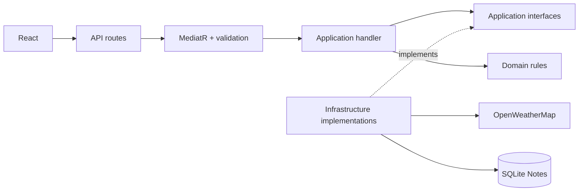
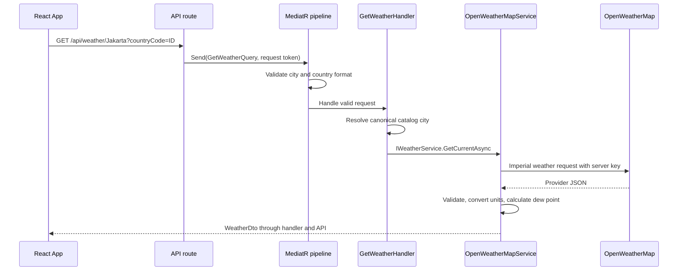

# Xtramile Weather: code walkthrough and Technical Lead interview guide

Prepared for **Muhamad Nizar Iqbal (@i4ba1)** on **7 October 2026**. Code baseline: `33d8e55` on `main`. Repository: [i4ba1/weather-app](https://github.com/i4ba1/weather-app).

This is one study document for explaining the maintained application code, tests, configuration, architecture, object-oriented concepts, and delivery workflow. It explains responsibilities and execution rather than reproducing every line. Generated dependencies, build output, local databases, secrets, and binary recording frames are not application source.

## Contents

1. [Project in two minutes](#1-project-in-two-minutes)
2. [Structure and dependency direction](#2-structure-and-dependency-direction)
3. [Backend code walkthrough](#3-backend-code-walkthrough)
4. [Frontend code walkthrough](#4-frontend-code-walkthrough)
5. [Patterns, OOP, and SOLID](#5-patterns-oop-and-solid)
6. [Contracts, persistence, and failure handling](#6-contracts-persistence-and-failure-handling)
7. [Tests and evidence](#7-tests-and-evidence)
8. [Configuration, Docker, CI, and AI tooling](#8-configuration-docker-ci-and-ai-tooling)
9. [Technical Lead interview preparation](#9-technical-lead-interview-preparation)
10. [Demo, exercises, and final checklist](#10-demo-exercises-and-final-checklist)

## 1. Project in two minutes

Suggested opening, adapted to your own words:

> This is an ASP.NET Core weather API with a separate React TypeScript frontend. A user selects a country and city, sees current conditions from OpenWeatherMap, and saves a weather note in SQLite. The backend follows Onion Architecture with folder-based layers and separates queries from commands through MediatR. Application handlers depend on interfaces, so provider and persistence implementations can be replaced in tests. The default tests are offline. Docker builds the frontend and backend into one application image, while a named volume preserves the SQLite file.

The implementation is deliberately bounded: five countries and thirteen cities, one application instance, one write use case, and no authentication or note-read endpoint. It is not an exhaustive world-location service or a production multi-tenant platform.

| Capability | Current implementation |
| --- | --- |
| Locations | Bundled read-only catalog; countries and cities served through queries |
| Weather | Current Weather HTTP API, imperial input, explicit DTO units |
| Note | Validated command, Domain entity, EF Core save, 201 acknowledgement |
| UI | Controlled selectors, loading/errors, metric card, note form |
| Architecture | Domain/Application/Infrastructure/API folders in **one backend assembly** |
| Storage | SQLite file, `Notes` table; weather and catalog are not stored there |
| Verification | xUnit, Vitest/RTL, Playwright, separate recorded smoke workflows |
| Delivery | Multi-stage Docker image, one Compose service, GitHub Actions |

Do not describe the single assembly as compile-time enforced layer isolation. Namespaces and project instructions establish the boundaries; separate projects or architecture tests would enforce them more strongly.

## 2. Structure and dependency direction

```text
weather-app/
├── WeatherApp.slnx                  # Backend and test solution
├── src/WeatherApp/
│   ├── Domain/                      # Entity and pure rule
│   ├── Application/
│   │   ├── Abstractions/             # Catalog, provider, repository ports
│   │   ├── Contracts/               # Response DTOs
│   │   ├── Common/                  # Validation pipeline and exceptions
│   │   ├── Countries/               # Country query and handler
│   │   ├── Cities/                  # City query, validator, handler
│   │   ├── Weather/                 # Weather query, validator, handler
│   │   └── Notes/                   # Note command, validator, handler
│   ├── Infrastructure/
│   │   ├── Locations/               # Bundled catalog implementation
│   │   ├── Weather/                 # OpenWeatherMap adapter and options
│   │   ├── Persistence/             # EF model/context and repository
│   │   └── DependencyInjection.cs   # Registration and configuration
│   ├── API/                         # Routes and exception translation
│   ├── Properties/                  # Local launch profiles
│   └── Program.cs                   # Composition and HTTP pipeline
├── tests/WeatherApp.Tests/          # Domain, handler, adapter and API tests
├── frontend/
│   ├── src/api/                     # Typed HTTP client/contracts
│   ├── src/components/              # LocationSelector, WeatherDetails, NoteForm
│   ├── src/test/                    # Fixtures and cleanup
│   ├── src/App.tsx                  # Selection and request state
│   ├── e2e/                        # Default mocked browser tests
│   └── recording/                  # Separate sample/live recordings
├── scripts/                        # Verification and video conversion
├── docs/                           # Design, plan, status, GIF, this guide
├── .github/workflows/ci.yml         # Automated checks and Docker build
├── Dockerfile / compose.yaml
├── AGENTS.md / README.md
└── .env.example                    # Placeholder, not a credential
```

### Onion Architecture: source dependencies versus runtime calls

Domain uses only the .NET base library. Application uses Domain, MediatR and FluentValidation but does not import concrete API or Infrastructure types. Infrastructure implements Application interfaces. The API routes dispatch requests; the composition root is allowed to know concrete Infrastructure registrations.



The handler invokes an Infrastructure object at runtime, but its source refers to an Application interface. That distinction is dependency inversion. A runtime call going outward does not require the core source code to depend outward.

### Read flow: weather



No database write takes place in this flow. The core use case does not know the provider URL, API key, or JSON schema.

### Write flow: note

The browser posts `{cityName, countryCode, text}`. The route sends `CreateWeatherNoteCommand`. The pipeline validates input, the handler resolves the canonical city and obtains UTC time, and the Domain constructor enforces invariants. The repository adds the entity and awaits `SaveChangesAsync`. Only then does the handler return its ID and timestamp and the endpoint send 201. The command does not require a successful weather-provider call: a selected catalog city is sufficient to save a note.

## 3. Backend code walkthrough

Paths in the following tables are relative to `src/WeatherApp/`.

### 3.1 Startup and Domain

| File / symbol | What the code does and why |
| --- | --- |
| `Program.cs` | Builds the host; registers application services, Problem Details and exception handler; creates a scope to initialize the database; installs error/static-file middleware; maps routes and fallback; starts the host. |
| `Program.cs`: `ThrowOnBadRequest` | Makes malformed minimal-API binding requests reach centralized exception handling as `BadHttpRequestException`, so the app can return consistent JSON errors. |
| `Program.cs`: fallback | For matching non-file fallback paths, returns JSON 404 for `/api` paths, non-GET requests, or missing frontend index. Other matching unmatched GET paths serve the built SPA index when it exists. Missing file-style URLs do not match this fallback. An unknown API path must not accidentally return React HTML. |
| `public partial class Program` | Makes the top-level entrypoint available to `WebApplicationFactory<Program>` for integration testing. |
| `Domain/Temperature.cs`: `ToCelsius` | Pure `(fahrenheit - 32) * 5 / 9` conversion. No HTTP, EF Core or UI dependency. It is a utility, not a temperature value object. |
| `Domain/WeatherNote.cs` | A sealed entity with GUID identity, city, country, text and UTC creation time. The public constructor validates lengths/nonblank values, trims strings, uppercases country code, and normalizes UTC. Private setters limit external mutation; the private parameterless constructor supports EF materialization. |

Domain validity and catalog membership are different concerns. The entity can verify that a country code is two ASCII letters; the handler verifies that the city actually belongs to the supported catalog. The entity does not fetch a country database.

### 3.2 Application ports, contracts and pipeline

| File / symbol | Responsibility |
| --- | --- |
| `Abstractions/ILocationCatalog.cs` | `GetCountries`, `GetCities`, and `Contains` define location access independently of bundled storage. `Contains` exists but handlers currently resolve a city from `GetCities` to obtain canonical spelling. |
| `Abstractions/IWeatherService.cs` | Asynchronous weather lookup returning `WeatherDto`, with a cancellation token. Hides provider transport and payload details. |
| `Abstractions/IWeatherNoteRepository.cs` | One explicit `AddAsync` operation. It is a use-case-sized repository, not a generic CRUD repository. |
| `Contracts/LocationDtos.cs` | `CountryDto(Code, Name)` and `CityDto(Name, CountryCode)` describe catalog responses. |
| `Contracts/WeatherDto.cs` | Record with 13 fields. Names encode units; nullable dew point and calculation flag explain availability/origin. |
| `Contracts/CreatedNoteDto.cs` | Record containing note `Id` and `CreatedAtUtc`; avoids returning the persistence entity. |
| `Common/ValidationBehavior.cs` | Generic `IPipelineBehavior<TRequest,TResponse>` collects all validator failures asynchronously, throws a `ValidationException` if any exist, otherwise calls the next delegate with cancellation. It runs before a handler dispatched through MediatR. |
| `Common/LocationNotFoundException.cs` | Stable application failure for unavailable catalog selections. |
| `Common/WeatherServiceException.cs` | `WeatherFailure` distinguishes Configuration, Upstream and Timeout. Exceptions contain safe user messages instead of raw provider URLs/responses. |

Validation runs sequentially for registered validators and aggregates their errors. Directly constructing a handler and invoking `Handle` in a test bypasses the pipeline; a test of pipeline behavior must instantiate it or call through the API/MediatR.

### 3.3 Queries and command

Each feature file groups a request, optional validator and handler. This combines Onion layering with organization by use case within Application.

| File | Execution |
| --- | --- |
| `Countries/GetCountries.cs` | `GetCountriesQuery` has no parameters. Handler checks cancellation and wraps the synchronous catalog result with `Task.FromResult` to satisfy MediatR's asynchronous contract. It performs no fake background work. |
| `Cities/GetCities.cs` | Validator requires a two-letter country code. Handler checks cancellation, gets cities, and throws not-found when no supported country matches. |
| `Weather/GetWeather.cs` | Validator requires a nonblank city of at most 100 characters and a two-letter country code. Handler checks cancellation, performs case-insensitive catalog matching, and passes canonical city/country plus the token to `IWeatherService`. |
| `Notes/CreateWeatherNote.cs` | Command contains city/country/text. Validator checks input shape and trimmed text length up to 2,000. Handler resolves a catalog city, constructs `WeatherNote` using injected `TimeProvider`, awaits repository save, then returns `CreatedNoteDto`. |

Requests and DTOs are C# records with value-oriented semantics. The Domain note is a class with entity identity. Record usage does not make mutable referenced collections deeply immutable.

### 3.4 Infrastructure registration and lifetimes

`Infrastructure/DependencyInjection.cs` registers MediatR handlers and validators by assembly scanning, adds the open generic validation behavior, binds weather options, and chooses the concrete catalog, weather client, context and repository.

| Registration | Lifetime / consequence |
| --- | --- |
| `ILocationCatalog` → `BundledLocationCatalog` | Singleton; no per-request mutable state, shared read-only catalog results. |
| `TimeProvider.System` | Singleton; replaceable clock for deterministic tests. |
| `IWeatherService` → typed `OpenWeatherMapService` | `AddHttpClient` typed client; client instances are managed through DI and underlying handlers are pooled by the HTTP client factory. Ten-second timeout and 1 MiB response-buffer limit. |
| `WeatherDbContext` | Default `AddDbContext` scoped lifetime; one context per request scope. Not thread-safe; do not use one context for concurrent operations. |
| `IWeatherNoteRepository` → `WeatherNoteRepository` | Scoped, matching context lifetime. |
| Weather options | Configuration bound from `OpenWeatherMap`; read through `IOptions<OpenWeatherMapOptions>`. This is not a dynamic `IOptionsMonitor` reload design. |

The connection string comes from `ConnectionStrings:Weather`. If absent, Testing uses `:memory:` and other environments use `data/weather.db`. File paths become absolute relative to the content root, and the directory is created. The API test factory holds an open in-memory SQLite connection so the database exists across request scopes.

### 3.5 Catalog and persistence

`Locations/BundledLocationCatalog.cs` keeps five countries and thirteen cities in read-only lists. A case-insensitive dictionary resolves country codes; city membership uses ordinal case-insensitive equality. City lists are sorted when built. The private static dictionary is not exposed for external mutation. This is an explicit limited catalog, not geocoding or a worldwide dataset.

`Persistence/WeatherDbContext.cs` inherits `DbContext`, exposes `DbSet<WeatherNote> Notes`, and configures the model through the Fluent API. `Id` is the primary key and `ValueGeneratedNever` means the Domain constructor supplies it. Required fields and length metadata are configured; do not assume SQLite enforces `HasMaxLength` as a strict database length constraint. Input/entity validation protects this workflow.

`Persistence/WeatherNoteRepository.cs` calls `context.Notes.AddAsync` followed by awaited `SaveChangesAsync`. Before saving, EF tracks the entity as Added. After a successful save it normally tracks it as Unchanged. Checking a fresh context with `AsNoTracking` demonstrates persisted state rather than merely inspecting the original tracked object. There is no separate Unit of Work class; `DbContext` already supplies change tracking and save coordination.

Startup uses `EnsureCreatedAsync`, not EF migrations. It creates a missing database/schema; it does not upgrade an existing schema after model changes. Production evolution needs a migration and data-preservation strategy. SQLite stores notes only; there is no weather snapshot or relationship to a country/city table.

### 3.6 OpenWeatherMap adapter

`Weather/OpenWeatherMapOptions.cs` contains `ApiKey`, initially empty. `Weather/OpenWeatherMapService.cs` implements the Application port.

`GetCurrentAsync` checks caller cancellation and configuration, escapes the combined city/country query, and requests `/data/2.5/weather` with `units=imperial`. An unsuccessful status becomes a safe Upstream exception. JSON parsing and mapping are internal to the adapter. Response and `JsonDocument` are disposed.

`Map` validates and translates the provider payload:

| Provider field | Output / guard |
| --- | --- |
| `main.temp` | Finite Fahrenheit within -200..200; Celsius from Domain conversion |
| `main.humidity` | Integer 0..100; relative humidity and dew-point input |
| `main.pressure` | Finite pressure from 1 through 1,200 hPa, inclusive |
| `wind.speed` | Finite nonnegative imperial speed up to 500 mph; multiplied by 0.44704 for m/s |
| `wind.deg` | Integer 0..360; missing direction defaults to 0 only when wind is calm |
| `visibility` | Nonnegative integer meters |
| `weather` | Must be a nonempty array; first item's nonblank `main` gives sky conditions |
| `sys.country` | Must match requested country, ignoring case |
| `dt` | Unix seconds converted to UTC observation time |

`Number` centralizes finite/range checks for floating-point values. Dew point uses `gamma = ln(RH/100) + 17.62*T/(243.12+T)` and `Td = 243.12*gamma/(17.62-gamma)`, where T is Celsius. At zero humidity it returns null rather than taking `ln(0)`. It is calculated, not a provider measurement. UI rounding occurs only at presentation time.

Provider timeout is distinguished from caller cancellation: an `OperationCanceledException` when the caller token is not canceled becomes Timeout. Caller cancellation propagates. Network and expected malformed-payload exceptions become Upstream. Raw transport exceptions are not attached to safe exceptions because they may contain the API-key URI. HTTP client logging is removed for this client for the same reason.

There is no weather cache, retry policy or circuit breaker. All provider non-success statuses, including 401 and 429, currently map to the same application upstream failure. Do not claim a provider-auth-specific status is exposed to the browser.

### 3.7 API routes and error translation

`API/Endpoints.cs` creates the `/api` group and dispatches through `ISender`; it never directly calls EF Core or `HttpClient`. GET handlers return serialized DTO results. POST returns JSON with 201 after the command completes. It does not send a Location header because there is no note-read URL.

`API/ApiExceptionHandler.cs` translates exceptions to Problem Details. Validation messages are grouped by property under `errors`, duplicates removed. Unexpected exceptions are logged with the request path and return a generic message. For caller-aborted cancellation/I/O exceptions, framework exception middleware normally handles 499 before custom handlers; the custom handler also has a defensive cancellation branch. A disconnected client may not receive any response. See the [request lifecycle guide](api-request-lifecycle-and-program-explained.md) for middleware-order details and framework sources.

## 4. Frontend code walkthrough

Paths below are relative to `frontend/`.

### 4.1 Mounting and state

`index.html` defines the root element, document metadata and module entry. `src/main.tsx` mounts `App` with `createRoot`, wraps it in `StrictMode`, and imports CSS. StrictMode helps expose effect cleanup mistakes in development; it is not a guarantee of thread safety or exactly-once requests.

`src/App.tsx` owns country/city lists, selected values, current weather, loading flags, and separate location/weather errors. Three effects load countries on mount, cities when country changes, and weather when city/country changes. Each effect owns an `AbortController`, checks whether it was aborted before setting state, and aborts on cleanup.

`changeCountry` clears city/options/weather/errors and starts the city-loading state; `changeCity` clears weather/error and starts weather-loading state. These resets stop old results from visually belonging to the new selection. An aborted late result is ignored even if an underlying promise still resolves.

`NoteForm` is rendered with a key containing country and city. Changing selection remounts the form, resets its local draft/feedback, and runs the old form's cleanup. Notes already accepted by the server are not rolled back by this remount.

### 4.2 API client and components

| File / function | Behavior |
| --- | --- |
| `src/api/types.ts` | TypeScript interfaces mirror backend camelCase JSON: locations, weather, note request/acknowledgement and Problem Details. UTC timestamps are strings in JavaScript. |
| `src/api/client.ts`: `request<T>` | Calls fetch, preserves cancellation, supplies a friendly connection error, parses JSON, extracts validation/detail/title errors for non-success responses, and returns typed payloads. |
| `src/api/client.ts`: `api` | Builds relative URLs with escaped path/query values; note POST sets JSON content type and serializes the command. No provider key belongs here. |
| `src/api/client.ts`: `errorMessage` | Safely converts an unknown caught value to display text. |
| `src/components/LocationSelector.tsx` | Controlled selects driven by props; explicit labels, loading placeholders, disabled states and callbacks. List keys use country code/city name. |
| `src/components/WeatherDetails.tsx` | Builds display metrics, rounds temperatures and wind speed, formats pressure/visibility, labels calculated dew point and displays null as Unavailable. Observation time is explicitly UTC. The decorative icon is static, not condition-specific. |
| `src/components/NoteForm.tsx` | Keeps text, saving, success/error state; blocks blank submission, trims the payload, awaits save and displays the returned ID. Uses refs for active cancellation and an immediate pending guard. |
| `src/styles.css` | Shared card/control/metric styling, focus-visible outlines, wrapping feedback, a two-column desktop layout and responsive breakpoints at 780px/400px. |

`request<T>` uses a TypeScript assertion (`payload as T`), not runtime schema validation. Strict TypeScript helps at compile time but cannot prove that incoming JSON matches the contract. A malformed successful response could still break component formatting; runtime schema parsing is a future improvement.

In `NoteForm`, `pending.current` changes immediately without waiting for a React render; `saving` triggers the visual disabled state. Both are needed for their different roles. Client duplicate-submit prevention is not server idempotency. A retried POST can still create another row because each command creates a new GUID.

Accessible labels, status/alert roles, `aria-live`, `aria-busy`, headings, semantic metric lists and focus styles support interaction and automated testing. These features are not evidence of a full accessibility audit.

## 5. Patterns, OOP, and SOLID

### 5.1 Patterns actually present

| Pattern / concept | Concrete example | Limit of the claim |
| --- | --- | --- |
| Onion Architecture | Framework-free Domain and inward Application dependencies | Folder/namespace boundary in one assembly, not separate-project enforcement |
| CQRS | Get queries versus `CreateWeatherNoteCommand` | One process/database; no broker, separate read DB or event sourcing |
| Mediator | Endpoints send requests through MediatR | In-process dispatch, not distributed messaging |
| Pipeline behavior | `ValidationBehavior` surrounds handler execution | One implemented cross-cutting behavior; no transactional/logging pipeline |
| Dependency injection | Handlers receive interfaces through constructors | Container assembly happens at the edge, not in Domain |
| Repository | `IWeatherNoteRepository` hides persistence | One specific operation; not an automatic abstraction for every EF feature |
| Adapter | Provider JSON translated by `OpenWeatherMapService` | Replacement providers must preserve DTO/unit/error semantics |
| DTO | Weather/location/creation records | Transport contracts, not persistence entities |
| Options | Typed API-key configuration | Uses `IOptions`, not live secret reload |
| Composition | Handler uses catalog, repository and clock | Preferred over a business-class inheritance hierarchy |

The app borrows Domain encapsulation and layered design, but it is not a large domain-driven system with aggregates, domain events or bounded-context messaging. Describe what exists rather than attaching extra pattern names.

### 5.2 The four OOP ideas in this code

**Encapsulation:** `WeatherNote` combines its state and validity rules; private setters prevent arbitrary external assignments. Encapsulation protects how an object can be created/changed, not just whether fields are hidden.

**Abstraction:** `IWeatherService` expresses what the use case needs without describing HTTP or OpenWeatherMap. `ILocationCatalog` and `IWeatherNoteRepository` do the same for location access and persistence.

**Polymorphism:** `OpenWeatherMapService` and test `FakeWeatherService` satisfy the same interface; the handler can call either without a type switch. Similarly, tests override `TimeProvider.GetUtcNow` for a fixed clock.

**Inheritance:** `WeatherDbContext : DbContext`, validators derive from `AbstractValidator<T>`, API factory derives from `WebApplicationFactory<Program>`, and the test fake HTTP handler derives from `HttpMessageHandler`. Business objects do not need an artificial inheritance tree to demonstrate OOP. React here uses functions and composition, not C#-style classes.

### 5.3 SOLID, with examples and caveats

| Principle | How to explain it here |
| --- | --- |
| Single responsibility | Route binds HTTP, handler coordinates a use case, repository persists, adapter parses provider data. The adapter is still responsible for several closely related mapping rules; extracting a mapper could help if it grows. |
| Open/closed | A different weather implementation can be registered without rewriting the handler, if it honors the contract. Changes to the DTO itself can still affect multiple layers. |
| Liskov substitution | A replacement service must honor units, canonical selection, cancellation and failure behavior expected by consumers. Implementing an interface alone does not prove behavioral substitutability. |
| Interface segregation | Three small ports let handlers depend only on needed concerns. `Contains` is currently unused by handlers, so it should be reconsidered if the contract expands. |
| Dependency inversion | Application defines ports; Infrastructure depends on and implements them. High-level use cases do not construct EF contexts or HTTP clients. |

### 5.4 C# and TypeScript concepts to explain

- Primary constructors express dependency injection concisely; they do not construct those dependencies themselves.
- `sealed` limits subclassing; interface implementation still allows substitution with different classes.
- `async`/`await` handles asynchronous I/O completion without creating a dedicated thread per request. Do not use `.Result`/`.Wait()` to block it or `Task.Run` to wrap normal network I/O.
- `Task.FromResult` adapts already-available catalog values; no asynchronous operation actually occurs there.
- LINQ supports case-insensitive resolution, sorting, and grouped validation errors. These catalog operations run in memory; they are not EF-generated SQL.
- `IReadOnlyList` limits mutation through the returned interface. The bundled implementation additionally wraps arrays with read-only collections.
- Cancellation is cooperative and should flow from request to handler to HTTP/persistence operations. A token is not an automatic rollback mechanism.
- TypeScript's `unknown` forces deliberate handling of untrusted values. Generic `request<T>` communicates a compile-time expected result but is not a JSON validator.
- React state is a render snapshot; refs persist mutable operational values without rerendering. Effect cleanup and stable dependency lists prevent obsolete work from updating the current UI.

## 6. Contracts, persistence, and failure handling

| Method / path | Success | Important failure cases |
| --- | --- | --- |
| GET `/api/countries` | 200 array of countries | Unexpected server failure |
| GET `/api/countries/{countryCode}/cities` | 200 city array | 400 malformed country; 404 unsupported country |
| GET `/api/weather/{cityName}?countryCode=ID` | 200 weather object | 400 invalid shape; 404 unavailable location; 502 provider/format failure; 503 missing key; 504 timeout |
| POST `/api/weather/notes` | 201 `{id, createdAtUtc}` | 400 invalid JSON/input; 404 unavailable catalog location; 500 unexpected storage/server failure |

Example note body (illustrative, not a live secret):

```json
{"cityName":"Jakarta","countryCode":"ID","text":"Warm and breezy today."}
```

Weather carries `city`, `countryCode`, `observedAtUtc`, `windSpeedMetersPerSecond`, `windDirectionDegrees`, `visibilityMeters`, `pressureHpa`, `skyConditions`, `temperatureFahrenheit`, `temperatureCelsius`, `dewPointCelsius`, `dewPointIsCalculated`, and `relativeHumidityPercent`.

Storage model: `Notes` has `Id`, `CityName`, `CountryCode`, `Text`, and `CreatedAtUtc`. A note is the user's observation, not a full weather snapshot. There is no owner/user ID, uniqueness rule for text, audit history, version token or note-query endpoint.

### Three validation boundaries

1. UI validation gives quick feedback and prevents obvious accidental submission.
2. Application validation protects commands/queries regardless of client and returns useful 400 details.
3. Domain construction protects the entity even when constructed outside the HTTP flow.

Provider validation is a fourth, separate boundary: external weather data must be parseable and plausible before it enters the DTO.

The city query/command resolves case-insensitive values to canonical catalog spelling. Whitespace around city/country is not normalized before matching by the handlers; do not promise that `" Jakarta "` is accepted just because the Domain entity trims its own values.

### Transaction and concurrency limits

For this single insert, relational EF Core save behavior provides the necessary atomic operation. No explicit multi-step transaction or distributed transaction is implemented. SQLite supports concurrent readers but serializes writes; this deployment is one instance with a modest write workload. Sharing its file volume across replicas is not a general scaling strategy.

If a client disconnects after the save commits, the row can exist even without a visible success message. Exactly-once writes would require server-side idempotency design and persistence of request identifiers. Notes are insert-only, so optimistic update-concurrency handling is not yet required or implemented.

## 7. Tests and evidence

Historical verification recorded for the release: **47 xUnit cases**, **6 React component tests**, **3 default Playwright tests**, plus separate sample and live recording runs. These are prior observed results, not a claim that all checks were rerun on 7 October for this documentation change. Counts include xUnit theory data cases; they are not 47 different test methods or a coverage percentage.

Paths in the backend table are relative to `tests/WeatherApp.Tests/`.

| File | What it verifies |
| --- | --- |
| `DomainTests.cs` | Freezing/boiling/negative/fractional conversion; trimming and basic note invariants |
| `LocationQueryTests.cs` | Queries with a fake catalog; bundled catalog membership and case-insensitive selection |
| `ValidationTests.cs` | Invalid country codes and the guarantee that pipeline validation prevents handler invocation |
| `WeatherQueryTests.cs` | Canonical location resolution, metric preservation, unavailable location and cancellation; contains the fake weather service |
| `WeatherAdapterTests.cs` | Fake `HttpMessageHandler` checks request units, mapping, dew point, malformed/impossible payloads, empty sky array, safe provider failures, timeout/cancellation and missing key |
| `NoteCommandTests.cs` | Unique EF InMemory stores, deterministic clock, trimmed/canonical saved row from a fresh context, and invalid/unknown input rejection |
| `WeatherApiFactory.cs` | Test host replaces the weather service and DbContext registrations, keeps an in-memory SQLite connection open, disposes it after the host |
| `ApiTests.cs` | Real route/pipeline/serialization behavior, 13 weather fields, 201 with actual stored note, Problem Details and invalid requests causing no inserts |
| `WeatherApp.Tests.csproj` | xUnit/test SDK, WebApplicationFactory, EF InMemory and coverage collector dependencies; references the app project |

The command persistence tests are not pure isolated unit tests: they use EF's InMemory provider and the repository. InMemory is not a relational database and cannot establish SQLite/SQL Server constraint, transaction or query behavior. The API tests use actual SQLite semantics in a temporary in-memory database to complement them.

Frontend and browser files:

| File | Responsibility / boundary |
| --- | --- |
| `frontend/src/test/fixtures.ts` | Deterministic synthetic weather fixture |
| `frontend/src/test/setup.ts` | jest-dom matchers, rendered-tree cleanup and global stub cleanup after each test |
| `frontend/src/App.test.tsx` | RTL/user-event with mocked fetch: all metrics, selected note payload, country reset, provider failure, stale weather, duplicate pending save, obsolete feedback and country-load errors |
| `frontend/e2e/weather.spec.ts` | Three real Chromium UI workflows with intercepted API calls: success, weather error and note validation error |
| `frontend/playwright.config.ts` | Discovers only `e2e`, starts/reuses Vite locally, uses a fresh server in CI, parallel tests and traces retained on failure |
| `frontend/recording/sample-data.json` | Explicit sample-weather DTO and note input |
| `frontend/recording/workflow.spec.ts` | Synthetic weather only; real catalog/note calls to native backend; visible sample caption, 201 assertion, selection reset, evidence and screenshot |
| `frontend/playwright.recording.config.ts` | Selects only sample workflow; one worker, slower actions, video/trace/report artifacts in `artifacts/e2e` |
| `frontend/recording/live.spec.ts` | Explicit live smoke workflow with no interception; actual weather and note responses, timestamped note, status evidence, selection reset and visible live caption |
| `frontend/playwright.live.config.ts` | Selects only live workflow, headed Chromium, separate outputs in `artifacts/live-e2e`; never selected by default offline suite |

Do not claim the default browser suite proves frontend-to-real-backend connectivity: all its API responses are intercepted. API integration tests and the separate backend-connected recording supply different evidence. The sample recording never calls live weather. The live run was explicitly authorized, is not CI, needs an active key, and was separately checked for actual SQLite persistence.

One real review finding is useful interview evidence: a provider `weather: []` initially caused an unexpected exception. A failing adapter regression test reproduced it; an explicit array-kind/nonempty check converted it to a controlled upstream failure. Explain the root cause, test and fix rather than saying the code was perfect on its first generation.

## 8. Configuration, Docker, CI, and AI tooling

### 8.1 Remaining project/configuration files

| File | Purpose |
| --- | --- |
| `WeatherApp.slnx` | Groups backend and xUnit projects; frontend is built separately with npm |
| `src/WeatherApp/WeatherApp.csproj` | .NET 10, nullable/implicit usings, MediatR 12.5.0, FluentValidation 12.1.1, EF SQLite 10.0.12, SQLitePCLRaw bundle 3.0.5 |
| `src/WeatherApp/appsettings.json` | Logging defaults and allowed hosts; contains no real API key |
| `src/WeatherApp/appsettings.Development.json` | Development logging configuration |
| `src/WeatherApp/Properties/launchSettings.json` | `http` profile on localhost:5000; HTTPS profile uses different ports. Vite proxy assumes the HTTP profile |
| `frontend/package.json` | Pinned package versions and dev/lint/test/build/browser/record scripts; React 19.3.0, TS 6.0.3, Vite 8.3.2, Playwright 1.63.0 in this baseline |
| `frontend/package-lock.json` | Resolved dependency graph/integrity information for reproducible `npm ci`; generated lockfile, not hand-written behavior |
| `frontend/tsconfig.json` | Strict type checking, modern DOM/ES libraries, JSX, JSON imports, no emitted JS, unused-symbol checks; includes source, e2e and recording code |
| `frontend/eslint.config.js` | JS/TS recommended rules, hook rules, browser/Node globals and output ignores |
| `frontend/vite.config.ts` | React plugin, `/api` proxy to port 5000; Vitest uses jsdom, test setup and source-only test discovery |
| `.env.example` | Compose key-variable placeholder; native `dotnet run` does not automatically load `.env` |
| `.gitignore` | Excludes credentials, database files, build/dependency output, reports, local tools/IDE state and the original assessment PDF; preserves the example env file and documentation GIF |
| `.dockerignore` | Excludes local secrets, databases and unnecessary build context such as dependencies/artifacts/tests |
| `README.md` | Setup, contracts, architecture, decisions, recordings, metadata and contributor attribution |
| `AGENTS.md` | Root Codex instructions: dependency boundaries, conventions, offline tests, verification and publication authorization |
| `docs/superpowers/specs/2026-10-04-xtramile-weather-design.md` | Approved recovery design, not executable code |
| `docs/superpowers/plans/2026-10-04-xtramile-weather.md` | Sequenced implementation plan and checks |
| `docs/superpowers/implementation-status.md` | Historical observed verification and limitations/decisions |
| `docs/media/weather-workflow.gif` | Committed live demonstration, embedded by relative README path |

The initial `.NET/Node` choices are pinned to the actual baseline. Do not call them the latest versions forever or assume a newer package is required simply because it exists. The README records the Apache-licensed MediatR version choice and the patched SQLite dependency choice.

### 8.2 Why one Docker container?

`Dockerfile` has three stages:

1. Node build stage runs `npm ci` and the TypeScript/Vite build.
2. .NET SDK stage restores/publishes the API and copies React `dist` into published `wwwroot`.
3. ASP.NET runtime stage copies only published output, creates a writable data directory for user `app`, exposes 8080 and runs the DLL as nonroot.

Build stages are not three permanent running containers. The final app serves both static React assets and API routes. SQLite is an embedded library operating on a file, not a daemon that requires a database container.

`compose.yaml` defines one `weather` service, port 8080, server-side key and connection-string variables, the `weather-data` volume, no-new-privileges and dropped capabilities. Notes survive container replacement because the file is in that volume. `docker compose down` retains it; `down --volumes` removes the stored data. A named volume is persistence, not a backup.

Native development instead runs Vite on 5173 and the API on 5000. Browser requests are same-origin to Vite and proxied server-side, so the default flow does not need a CORS policy. A separately deployed frontend/API origin would need a deliberate proxy/CORS/authentication design. TLS termination, health checks, production backups and monitoring are not configured here.

### 8.3 Verification, CI and recording converter

`scripts/verify.ps1` restores/installs only when requested, otherwise runs Release build/test and frontend lint/component tests/build/default Playwright. `Invoke-Check` throws on a nonzero exit code; nested `try/finally` restores the working directory. It does not run live weather or automatically run the sample recording.

`.github/workflows/ci.yml` runs on push/pull request using Ubuntu, installs .NET 10 and Node 22, restores dependencies and Chromium/Linux dependencies, runs the offline suite, validates Compose and builds the image. It does **not** start the image and assert persistence or run a live provider test. Those were separate local smoke checks.

`scripts/convert-e2e-video.py` parses optional FFmpeg/artifact-directory arguments, finds exactly one workflow WebM, converts it to H.264 MP4 and an animated GIF, checks nonempty outputs and fully decodes the MP4. `subprocess.run(..., check=True)` fails on conversion errors. The workspace-local `imageio-ffmpeg` tool supplies an executable if an explicit path is absent. MP4/GIF are presentation evidence, not replacements for assertions or database checks.

### 8.4 Security and production boundary

The provider key stays in backend environment/configuration, not React variables, committed source or image build arguments. Provider request logging is disabled; API failure messages are sanitized. Git/Docker ignore rules are safeguards, not secret-management systems.

Before exposing this app publicly, discuss authentication/authorization for notes, HTTPS, allowed-origin/host policies, rate limiting, secret rotation/storage, provider limits, durable backups, schema migrations and safe operational logs. None is implemented just because the architecture allows it. Do not describe note text as healthcare data or claim compliance controls based on the interviewer's industry.

For higher write concurrency or multiple replicas, SQL Server/PostgreSQL becomes a serious option. Changing a connection string alone is insufficient: select the EF provider, design migrations, move existing notes safely, test provider-specific mappings/queries and transactions, supply credentials/health checks/backups, and only then change Compose. Application ports reduce the impact; they do not eliminate it.

## 9. Technical Lead interview preparation

### 9.1 What can be established about the interviewer?

The supplied [LinkedIn profile](https://www.linkedin.com/in/juldhais/) was not directly fetchable during preparation. His [public personal site](https://juldhais.net/) identifies **Juldhais Hengkyawan** as a Technical Lead at Xtramile and lists C#/SQL/JavaScript, ASP.NET Core/React, SQL Server/PostgreSQL, and Azure among his experience/skills. Those public professional facts were checked on 7 October 2026; they do not establish his interview format or preferred answer.

**Inference for preparation:** prioritize .NET fundamentals, architecture choices, database behavior, test credibility, delivery, and the ability to explain business tradeoffs. The questions below are practice questions derived mainly from this repository. They are not confirmed questions from him, a private assessment rubric, or an inference about his personality.

Start with these eight topics if time is limited:

1. Trace a weather request and note command from React to the implementation.
2. Explain Onion source dependencies versus runtime calls and the single-assembly limitation.
3. Explain CQRS without claiming event sourcing or separate databases.
4. Defend SQLite's scope and describe a safe SQL Server migration.
5. Explain DI lifetimes, async I/O and request cancellation.
6. Demonstrate saved-state verification and distinguish each test boundary.
7. Explain Docker's build stages, one runtime service, and persistent volume.
8. Describe AI assistance honestly and show one bug you verified and corrected.

### 9.2 Architecture and design questions

**Q1. Can you explain the project without opening any code?**

Suggested answer: “It provides catalog selection, current weather and persistent notes. React manages the browser interaction; ASP.NET routes dispatch use cases through MediatR. Domain owns core validity, Application owns orchestration/interfaces, and Infrastructure owns the provider and database. Queries read; the note command writes. Tests replace external concerns, and one Docker app serves the production UI/API.” Then open `Program.cs` and trace one concrete request.

**Q2. Why Onion Architecture for a small weather application?**

“The assessment calls for decoupling, and these boundaries make provider/persistence replacement and testing explicit. There is some extra boilerplate for a small app, so I kept one assembly, small interfaces and four use cases rather than adding services, events or a broker.” If challenged, concede that a simpler layered app could meet the functional needs; the architectural choice serves the assessment and change boundaries.

**Q3. Is Onion actually enforced when every layer is in one project?**

“It is enforced by source organization, instructions and review, not project references. Application source does not reference Infrastructure, but the compiler could allow that mistake. Separate Domain/Application/Infrastructure/API projects or architecture tests would strengthen enforcement.” Do not claim a test name containing “without infrastructure dependency” proves whole-assembly import rules.

**Q4. Why CQRS? Where is the decoupling?**

“Read requests and the state-changing command have separate request/handler contracts. The API does not contain their implementation. `GetWeatherHandler` calls `IWeatherService`; the note handler calls `IWeatherNoteRepository`. This is simple in-process CQRS, and one database is sufficient. A command/query split does not require event sourcing.” Point to the feature request records and endpoint dispatch.

**Q5. Does MediatR itself guarantee CQRS or clean architecture?**

“No. It routes requests and applies behaviors. A handler could still directly use concrete storage or mutate state in a query. Our dependency choices and handler responsibilities establish CQRS; MediatR organizes execution.” Removing MediatR would not remove the possibility of the architecture, but would require alternative dispatch/validation wiring.

**Q6. Why put interfaces in Application rather than Infrastructure?**

“They describe what a use case needs, so the core owns the contracts. Infrastructure implements them. If Application imported Infrastructure to get its interface, the dependency would point outward.” Show `IWeatherService` and the constructor of `GetWeatherHandler`.

**Q7. Is a repository necessary when EF Core already has repository/unit-of-work behavior?**

“Not always. This repository is a small architectural port so Application remains independent of EF Core and tests can replace persistence. A generic repository duplicating all of EF would add little value. For more complex operations I would reconsider whether saving belongs inside each method or at a use-case transaction boundary.” The current `AddAsync` saves immediately, which matters for future multi-step commands.

**Q8. Where are the business rules, and why validate twice?**

“The validator returns useful input errors before the handler, while the entity prevents invalid creation through any entry point. Supported-location resolution is a use-case rule in the handler. Repeating basic invariants is intentional defense of the Domain boundary; tests should prevent rule drift.” Explain that maximum note length is checked after trimming, while the browser also applies a raw input limit.

### 9.3 OOP, C# and runtime questions

**Q9. Show encapsulation, abstraction, polymorphism and inheritance in your code.**

“The note constructor/private setters encapsulate validity. Application ports abstract external operations. Real/fake weather services provide interface polymorphism. EF context, validators and test HTTP handlers use framework inheritance. Business behavior mostly uses composition.” Open the actual entity/interface/fake rather than reciting definitions alone.

**Q10. Why records for requests/DTOs and a class for the entity?**

“Requests and DTOs are data-shaped values with concise constructors and value equality. A note has identity and controlled lifecycle, so it is an entity class. Records are not automatically deeply immutable, and private setters in a class are not the same as a fully immutable type.”

**Q11. What does async/await improve? Does every call get a new thread?**

“HTTP/database waits can complete asynchronously without occupying a request thread for the whole wait. Async is not a promise of a new thread or parallel execution. The catalog is already in memory and uses `Task.FromResult`; there is no reason to wrap it in `Task.Run`.” Avoid claiming that EF `AddAsync` itself is the meaningful database write; `SaveChangesAsync` performs persistence here.

**Q12. What are your DI lifetimes and what can go wrong?**

“Catalog and clock are singleton; DbContext/repository are scoped; the weather service is a typed HTTP client. A singleton must not capture the scoped DbContext, and a context must not be used concurrently. The factory manages reusable HTTP handlers rather than creating a new socket stack for every provider call.”

**Q13. Why inject TimeProvider?**

“A fixed clock lets the test assert an exact timestamp without racing wall-clock time. The same handler works with `TimeProvider.System` in production. Time is an explicit dependency, while GUID identity remains generated by the entity.” Point to `FixedTime` in `NoteCommandTests.cs`.

**Q14. What happens when the user navigates while saving?**

“The keyed form unmounts and aborts its request, suppressing obsolete feedback. Cancellation is cooperative. If SQLite already committed, the note remains attached to the original selected city. Cancellation does not guarantee rollback or exactly-once behavior.” Explain the ambiguous outcome if a response is lost after commit.

**Q15. How do timeout and client cancellation differ?**

“The provider client has a ten-second timeout. If an operation is canceled but the caller token is not canceled, the adapter classifies a timeout and the API returns 504. If the caller canceled, it propagates cancellation; the API handles request-aborted cancellation separately.” They are different operational conditions and should not both be called provider failures.

### 9.4 EF Core and database questions

**Q16. Why SQLite rather than SQL Server?**

“It satisfies a single-instance assessment with a small note-write workload, simple setup and persistent relational storage. It avoids running/managing a database server just for this scope. I would choose SQL Server or PostgreSQL when concurrency, multiple replicas, operational tooling or organizational requirements justify it.” This is a bounded choice, not a claim that SQLite is always enough.

**Q17. Why no SQLite container?**

“SQLite is an embedded library that reads/writes a file in the application process. Compose mounts a persistent volume for that file. A separate container is useful for a server database; inventing a SQLite server container would change the design rather than add necessary isolation.”

**Q18. What would moving to SQL Server actually require?**

“Change the EF provider and registration, design initial/evolution migrations, migrate existing notes, verify GUID/date-time/string mappings and relational behavior against SQL Server, and configure the database service/credentials/backups. Keep Application ports/handlers stable where possible. A connection-string-only change would not be sufficient.” Add deployment/load tests before promising multi-instance support.

**Q19. Explain EF Core state management for note creation.**

“The context tracks a new note as Added; saving issues the insert and successful state becomes Unchanged. We await it before returning. A fresh context with `AsNoTracking` reads the persisted row, avoiding a false pass from the original tracked object.” There are no runtime EF read queries in the current use cases.

**Q20. Why EnsureCreated instead of migrations?**

“The bounded assessment starts with a fixed schema, so creation is simple. It is not an update strategy. For schema evolution I would adopt migrations deliberately and preserve existing data; I would not mix creation and migrations casually or delete a user's database to make a deployment pass.”

**Q21. Are transactions, concurrency and duplicate prevention handled?**

“The current operation is one relational save. There is no explicit multi-step transaction, update concurrency token or server idempotency key. The UI blocks duplicate clicks during a pending save, but repeated accepted POSTs create distinct notes.” For future updates use optimistic concurrency; for retryable creation design idempotency storage/constraints.

**Q22. Does HasMaxLength enforce limits in SQLite?**

“It configures model metadata, but SQLite does not generally enforce varchar lengths the way another provider might. Our validators and Domain checks enforce the workflow limits. Database constraints should be considered separately when stronger integrity guarantees are needed.”

### 9.5 API and provider questions

**Q23. Why not call OpenWeatherMap directly from React?**

“The server protects the API key, normalizes units/contracts and translates provider errors. React calls our stable API. This also lets us test the provider separately and replace it without redesigning every component.” Frontend build variables are public output, not a secure secret store.

**Q24. Why request imperial units if the UI shows Celsius?**

“The implementation preserves Fahrenheit and uses the Domain conversion for Celsius. Wind mph is converted separately to m/s. DTO names make units explicit. I would not assume every returned metric changes units identically just because the request says imperial.” Show the adapter mapping test.

**Q25. Is dew point measured or calculated?**

“The current payload does not provide it in this mapping, so we calculate an approximation from Celsius and relative humidity and label it calculated. At zero humidity it is unavailable. We retain precision in the DTO and round for display.” Be ready to explain why zero humidity makes the logarithmic formula unsuitable.

**Q26. What do 400, 404, 502, 503 and 504 mean here?**

“400 is invalid binding/validation; 404 is an unsupported selection/route; 502 is provider non-success or invalid provider data; 503 is missing local provider configuration; 504 is provider timeout. Unexpected server failures are generic 500 responses. An OpenWeather 401 currently becomes our safe 502, not a leaked provider message.”

**Q27. How do you handle rate limits and provider outages?**

“The current code has a timeout and safe error mapping. It has no retry/cache/circuit breaker. For a broader deployment I would add provider-aware resilience and caching with expiry, bounded retries for appropriate read failures, and metrics; I would not retry invalid credentials or arbitrary POSTs blindly.” Clearly distinguish proposed improvements from implemented behavior.

**Q28. Is this RESTful? Why no Location header on 201?**

“It uses resource-oriented HTTP routes and standard success/error payloads, but the note API is intentionally create-only. It returns 201 plus an ID/timestamp, and omits a Location header because a GET endpoint for that note does not exist. Adding note retrieval would require an explicit contract and, for user-owned data, authorization.”

### 9.6 React and testing questions

**Q29. How do you prevent a slow Jakarta response replacing Bandung's weather?**

“Selection effects own controllers. On selection change, cleanup aborts the prior controller and resolution checks whether it was aborted before setting state. The component test intentionally resolves an old promise late and verifies Bandung stays visible.” Cancellation plus guards handle both real fetches and delayed test promises.

**Q30. Why use both a ref and state for pending submission?**

“The ref provides an immediate guard before React rerenders; state drives the Saving/disabled UI. They solve different problems. Remounting on city/country change also isolates the form's draft and feedback.”

**Q31. Does TypeScript validate the backend JSON?**

“No. `payload as T` is a compile-time assertion. Runtime schemas or a generated-and-validated client would improve this boundary. The provider adapter does perform runtime validation on its input, but that does not automatically validate every frontend response.”

**Q32. Does your Playwright test really run against the backend?**

“The default three tests mock every API response, so they prove browser interaction/error behavior only. API tests exercise the real backend with fake weather and isolated SQLite. The separate sample recording uses real catalog/notes with fake weather; the explicit live recording exercises the provider too. Its returned note ID was independently checked in SQLite.” This answer should be precise rather than simply “we have E2E coverage.”

**Q33. Why not run live provider calls in CI?**

“They add credential management, rate limits, external availability and variable data to a test that should be deterministic. Fake transport responses cover contract/error parsing, and a separate authorized smoke run checks the deployed integration.” Do not claim fixtures prove a provider's current availability.

**Q34. Is EF InMemory enough to test persistence?**

“It helps exercise orchestration and state, but not relational behavior. We complement it with SQLite-backed API tests and actual file/container persistence smoke checks. A SQL Server deployment should have tests against SQL Server rather than trusting SQLite/InMemory for all semantics.”

**Q35. Do 47 tests mean full coverage?**

“No. The count includes theory cases, and no coverage percentage is asserted. Important gaps include load/concurrency, auth, backups, schema evolution, runtime frontend schema checks and a full accessibility audit. I would prioritize tests by operational risk rather than inflate the count.”

### 9.7 Delivery, ownership and improvement questions

**Q36. Why is the frontend not a separate runtime container?**

“React produces static assets. Serving them through ASP.NET Core gives one origin and a simple release artifact. Nginx/CDN deployment would make sense if we need independent releases/caching/scaling, but it would introduce routing and deployment decisions. The separate source directory already preserves frontend organization.”

**Q37. How do you prove data survives Docker rebuilds?**

“The connection points into the named volume, not the replaceable image/container layer. The smoke check created a note, replaced the container without deleting the volume and compared stored data. A volume persists data but is not a backup; deleting volumes deletes notes.”

**Q38. What does your CI prove, and what does it not prove?**

“It proves build/type/lint/tests, Compose syntax and image construction for that run. It does not automatically prove a running container is healthy, database backups work, migration rollout succeeds or the live provider account is active.” Show `.github/workflows/ci.yml` rather than assuming steps it does not contain.

**Q39. How did you use AI, and can you explain the code yourself?**

Suggested honest framing: “Codex and Superpowers assisted planning, implementation and verification. The root AGENTS instructions defined boundaries and checks. I can explain the resulting flow and test evidence, and I take responsibility for reviewing decisions and limitations.” Use only claims that match your actual involvement. Do not claim you hand-wrote generated code or independently made every decision if that is untrue. Demonstrate ownership by explaining a specific handler and a test, not by citing prompt files alone.

**Q40. What bug did review find? What did you learn?**

“An empty provider weather array escaped the intended error handling. A regression test failed on that payload; we added explicit nonempty-array validation and reran the suite. The lesson is to validate assumptions at external boundaries and prove corrections with a test.” This is stronger evidence than claiming generation or code review prevented every bug.

**Q41. What would you improve first for production?**

“I would first establish deployment requirements: who can create/read notes, expected traffic, data-retention/recovery needs and provider limits. Then prioritize auth/authorization, TLS/secrets/rate limits, migrations/backups/health monitoring and provider resilience. Multi-instance database choice follows those requirements, not container aesthetics.” Be clear that this is a proposal, not current functionality.

**Q42. If the reviewer says the architecture is over-engineered, how do you respond?**

“I would ask which complexity is not paying for itself, explain the assessment's decoupling requirement, and identify simplifications. Small ports and handlers isolate provider/persistence risks, but I avoided separate deployable services and generic infrastructure. I can accept a simpler design if the team's priorities favor it.” Demonstrate judgment and openness rather than defending every library as mandatory.

### 9.8 Answers that would undermine credibility

| Avoid saying | Accurate replacement |
| --- | --- |
| “Onion is enforced by four projects.” | “There are four layer folders in one app project.” |
| “CQRS requires two databases.” | “Command/query separation works with one database here.” |
| “Every test is a real end-to-end integration.” | “Different suites isolate different boundaries.” |
| “AbortController rolls back a saved note.” | “It cancels/ignores client work; committed rows can remain.” |
| “TypeScript proves the JSON shape.” | “Runtime validation is a separate concern.” |
| “SQLite runs in its own service.” | “It is embedded; the database file is in a volume.” |
| “Changing the connection string migrates to SQL Server.” | “Provider, schema, data and tests also need migration.” |
| “EnsureCreated upgrades the database.” | “It initializes; it is not schema evolution.” |
| “Docker/AI/tests make this production-ready.” | “They provide evidence and tooling within the documented scope.” |
| “These are definitely Juldhais's questions.” | “These are informed practice questions, not a confirmed interview script.” |

## 10. Demo, exercises, and final checklist

### 10.1 A focused 10–15 minute presentation

| Time | Show / explain |
| --- | --- |
| 0–2 minutes | Product goal, scope and architecture diagram |
| 2–5 minutes | `Endpoints` → validation → weather handler → interface → provider adapter |
| 5–7 minutes | Note command → Domain invariants → repository → save acknowledgement |
| 7–9 minutes | React effects/cancellation, form key and pending-submit guard |
| 9–11 minutes | Adapter edge-case test, SQLite API persistence assertion, browser test boundary |
| 11–13 minutes | Docker stages/volume and CI; acknowledge production limits |
| 13–15 minutes | Tradeoffs, review bug, AI disclosure and questions |

Use the [committed GIF](media/weather-workflow.gif) as historical evidence, not a substitute for understanding the code. Live weather may differ from the recording. Have the deterministic sample demo available if the provider is unavailable.

### 10.2 Commands to know

From the repository root, after installing .NET 10 and a compatible Node 22 version:

```powershell
dotnet restore WeatherApp.slnx
cd frontend
npm ci
npx playwright install chromium
cd ..
./scripts/verify.ps1
```

For native development, set the backend key privately in its terminal and run `dotnet run --project src/WeatherApp --launch-profile http`. In a second terminal run `npm run dev` from `frontend/`. Open localhost:5173; the API is localhost:5000. Without a key, the catalog and note operation still work, but weather returns 503.

Docker uses a root `.env` containing the key placeholder's actual value, then:

```powershell
docker compose up --build -d
docker compose ps
```

Open localhost:8080. Never display `.env`, `docker inspect` environment output, or provider URLs containing the key during a screen share. The app's API endpoint can be called without putting the provider key in the demo URL.

The offline sample recording requires the two native services and an isolated note database; see README setup. From `frontend/`, `npm run test:e2e:record` runs synthetic weather with real note persistence. The separately authorized live command is `npx playwright test --config playwright.live.config.ts --headed`; it is not part of ordinary verification and makes real provider calls.

### 10.3 Rehearsal exercises

These are exercises to explain or implement during practice, not changes already present:

1. **Add a catalog city:** find the catalog, prove country/city behavior with a test, and explain why the existing API contract need not change.
2. **Replace the provider:** implement the same weather port with a fake, register it, and show that the handler/UI contract stays stable.
3. **Add note retrieval:** identify DTO/query/repository-read/API/UI changes, `AsNoTracking`, paging and owner authorization needs before coding.
4. **Add runtime response validation:** explain why `request<T>` alone is insufficient and how an invalid successful response should produce a readable error.
5. **Design duplicate prevention:** distinguish UI pending state from a persisted idempotency key, including “save succeeded but response was lost.”
6. **Design a SQL Server move:** explain provider selection, schema/data migration, tests, credentials and rollout/backup checks.

For a live coding question, state the behavior, name the boundaries, write a focused failing test where appropriate, then implement and verify. Do not edit the secret file or run destructive database cleanup to make an exercise pass.

### 10.4 Questions you can ask the Technical Lead

- “For this assessment, which tradeoff matters most: simplicity, strict dependency enforcement, or production deployment readiness?”
- “Does the team's usual CQRS approach use direct EF queries, repositories, or another data-access boundary?”
- “What database concurrency and operational requirements would you expect before moving this app from SQLite to SQL Server?”
- “What review and verification standards do you apply to AI-assisted changes?”
- “Which improvement would you prioritize before exposing this workflow to real users?”

### 10.5 Last preparation checklist

- [ ] Explain the weather and note flows without reading a prepared answer.
- [ ] Locate every source file in the walkthrough and explain its responsibility.
- [ ] Show one interface replacement and one Domain invariant.
- [ ] Distinguish compile-time types, runtime validation and relational constraints.
- [ ] Explain scope lifetimes, async I/O, cancellation and commit ambiguity.
- [ ] Explain exactly which tests mock which boundaries.
- [ ] Show independent persisted-state evidence instead of only a success toast.
- [ ] Explain one-container Docker delivery and data-volume retention.
- [ ] State missing production capabilities without claiming they already exist.
- [ ] Describe AI involvement and your actual decisions honestly.
- [ ] Keep credentials out of the document, demo output and screen share.

### Sources and maintenance

Project explanations are based on the files in this checkout at the stated baseline, with prior verification evidence in [implementation status](superpowers/implementation-status.md) and [README](../README.md). Interviewer context is limited to the professional information on [his public site](https://juldhais.net/) and the [profile supplied by the user](https://www.linkedin.com/in/juldhais/). Question selection and future-improvement answers are author analysis, not attributed interviewer statements.

When code changes, review the file inventory, request flows, contract fields, versions and test boundaries before relying on this guide. Do not update historical test results merely because the document was edited.
