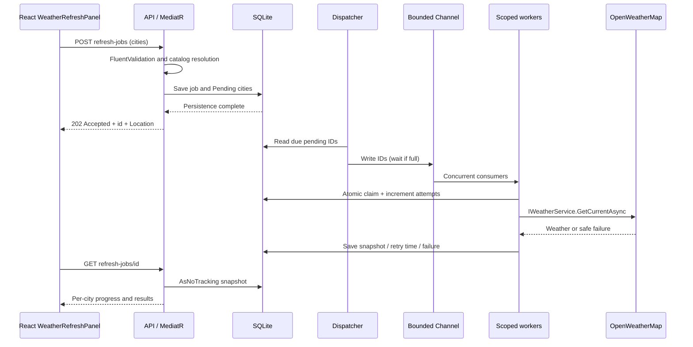
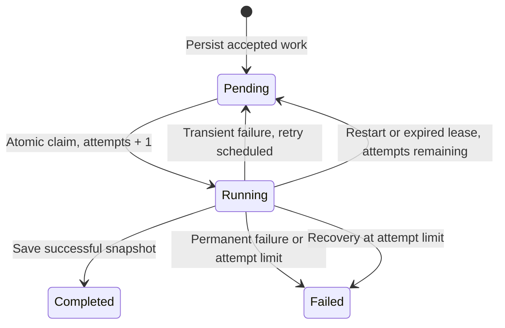

# Background weather refresh: Channels, CQRS and recovery

This extension implements the user-approved multi-city background refresh in the existing .NET 10 / React TypeScript application. It requires no separate project or container. The original single-city GET and notes workflow remain available.

## Code responsibilities

| File | Responsibility |
| --- | --- |
| [WeatherRefreshItem.cs](../src/WeatherApp/Domain/WeatherRefreshItem.cs) | Framework-free job/city entities and completion/failure rules |
| [CreateRefreshJob.cs](../src/WeatherApp/Application/RefreshJobs/CreateRefreshJob.cs) | Batch validation, supported-location resolution and persistence before acknowledgement |
| [GetRefreshJob.cs](../src/WeatherApp/Application/RefreshJobs/GetRefreshJob.cs) | Read-only MediatR query, unknown job handling |
| [RefreshJobDtos.cs](../src/WeatherApp/Application/RefreshJobs/RefreshJobDtos.cs) | API contracts |
| [IWeatherRefreshRepository.cs](../src/WeatherApp/Application/Abstractions/IWeatherRefreshRepository.cs) | Application persistence interface |
| [WeatherRefreshRepository.cs](../src/WeatherApp/Infrastructure/Persistence/WeatherRefreshRepository.cs) | EF Core snapshots, atomic claims, persistence and recovery |
| [WeatherDatabaseInitializer.cs](../src/WeatherApp/Infrastructure/Persistence/WeatherDatabaseInitializer.cs) | New-database initialization and additive upgrade preserving Notes |
| [WeatherRefreshQueue.cs](../src/WeatherApp/Infrastructure/RefreshJobs/WeatherRefreshQueue.cs) | Bounded in-memory channel, deduplication and backpressure |
| [WeatherRefreshService.cs](../src/WeatherApp/Infrastructure/RefreshJobs/WeatherRefreshService.cs) | Hosted dispatcher, workers, provider pacing, retry scheduling and recovery |
| [WeatherRefreshOptions.cs](../src/WeatherApp/Infrastructure/RefreshJobs/WeatherRefreshOptions.cs) | Queue/worker/interval settings, validated at startup in dependency registration |
| [WeatherRefreshPanel.tsx](../frontend/src/components/WeatherRefreshPanel.tsx) | Submit selected-country cities, poll status, resume from browser storage and show partial results |

The Channel is an Infrastructure detail. Application commands and queries depend on the repository interface, not on Channel, EF Core or HTTP implementations. MediatR is an in-process dispatcher; Channel is a separate producer/consumer delivery mechanism. Domain depends on neither. The domain's opaque snapshot string is serialized/deserialized by Infrastructure, so it introduces no JSON framework dependency into Domain.

## Work states

Jobs aggregate city states. A job with active work is Running/Pending. After every city finishes, all successes produce Completed, all failures produce Failed, and mixed results produce CompletedWithErrors. HTTP 202 acknowledges persistence, not weather success. GET returns 200 for a found job even when that job contains provider failures; clients inspect its state.

## Recovery design

1. **Before delivery:** jobs and every city are saved in one EF Core save. The command does not depend on immediate channel availability. If the process stops before enqueue, the dispatcher later discovers persisted Pending work.
2. **Queue saturation:** FullMode.Wait prevents dropping IDs. Outstanding IDs remain deduplicated until their consumer finishes. Cancelled enqueue removes its dedup entry; the persisted row remains available.
3. **During execution:** an atomic database update claims only due Pending work and records the attempt/start time. Each consumer uses its own scope and context. Provider calls are read-only and can safely repeat, although repeats consume provider allowance.
4. **After interruption:** startup resets Running work with attempts remaining to Pending. Running work at the limit becomes Failed. Completed snapshots are untouched. During a live run, claims older than two minutes are recovered so a failed save does not strand work permanently; normal provider timeout is ten seconds.
5. **Retries:** only transient errors retry; next-attempt timestamps are durable Unix milliseconds. Defaults permit three total attempts with 2-second then 4-second backoff. Safe messages are stored, never raw exception strings or credential-bearing URLs.
6. **Shutdown and browser lifecycle:** workers receive the host shutdown token. Browser cancellation applies to submit/poll requests; a persisted accepted job survives page closure. Poll failure offers Retry status without submitting another job. Dismissing tracking does not cancel server work.

These mechanisms provide at-least-once recovery for a single app instance. They do not provide distributed ownership, exactly-once calls, or a provider-wide quota shared with the direct weather endpoint. A durable broker/leases with fencing would be needed before multiple instances share this workload. Jobs have no automatic retention; monitor database growth if this is used beyond the assessment/demo.

## Verification

Run `scripts/verify.ps1` from the repository root. Automated tests use synthetic fixtures explicitly labeled as test data and isolated SQLite files; no live external requests are made. Backend coverage includes concurrent calls, retry exhaustion, partial failure, restart recovery, old Notes schema upgrade, read-only status queries, and queue saturation/cancelled enqueue. React and Playwright cover submission, partial results, persisted browser tracking and polling. Provider adapter tests distinguish retryable HTTP failures from permanent failures.

The historical walkthrough and Program.cs guide describe the original release. This document describes the channel extension and its additional startup initialization, registrations, routes and files.
